# Orbifex

**The world-maker for agent evals.**

<p align="center">
  
</p>

Orbifex builds **universes**: believable worlds around a person or a company, with their people, clients, projects, and history, and every Slack thread, Notion page, email, contract, and spreadsheet that world would produce. It keeps each world **continuous** across every app, proves each **artifact** is sound before keeping it, serves the world to agents through **synthetic connectors**, and turns it into **benchmarks** with answers you can trust.

Think of it as a flight simulator for AI agents doing office work: a believable place to operate in, and an answer key.

*Orbis* is Latin for world, and *-fex* means maker, as in *artifex*. Orbifex is part of the [Consul](https://github.com/nbdesai1992/consul) family: Consul builds software; Orbifex builds the worlds agents are tested in.

> **Status: design only.** This repo holds the design and the research behind it, so the design can change quickly. No engine code yet. The research in [`research/`](research/README.md) stands on its own.

---

## Contents

1. [Design philosophy](#1-design-philosophy)
2. [Components, each usable on its own](#2-components-each-usable-on-its-own)
3. [Continuity: the method](#3-continuity-the-method)
4. [Artifact quality: the method](#4-artifact-quality-the-method)
5. [The agent loop](#5-the-agent-loop)
6. [Method, component by component](#6-method-component-by-component)
7. [Benchmarks: answers first](#7-benchmarks-answers-first)
8. [Where people sit](#8-where-people-sit)
9. [Files, data model, and layout](#9-files-data-model-and-layout)
10. [Metrics, release, and contamination](#10-metrics-release-and-contamination)
11. [Build order and next steps](#11-build-order-and-next-steps)
12. [Open questions](#12-open-questions)

---

## 1. Design philosophy

Six ideas carry the whole design. Each comes from the research in [`research/`](research/README.md).

### 1.1 One world, many views

Everything starts from a single **world graph**: typed, time-stamped facts about people, organizations, projects, contracts, decisions, and events. Every artifact is a view of that graph, rendered in the voice of the person who wrote it and the format of the app it lives in. Every answer in a benchmark is computed from the graph, never guessed by a model.

*Why:* the strongest synthetic-company work does exactly this, and it is the only way to guarantee answers are right (CorporateBench, Era by Eon, HERB, EntiGraph).

### 1.2 Continuity is checked, not hoped for

One decision in a meeting should show up in the transcript, the Slack follow-up, the Notion page, and the email to the client, with realistic timing. When something disagrees, it is either a planted, tagged piece of mess or an error, and errors get fixed.

<p align="center">
  
</p>

*Why:* cross-source coherence is what makes a world realistic, and incoherence is what makes synthetic data easy to spot (EnterpriseRAG-Bench, HERB). Continuity is the film term for the same job: the script supervisor makes sure the coffee cup is in the same hand in every shot.

### 1.3 Every artifact earns its place

A maker agent writes each file. Then code and a different model check it. A file that fails is repaired on the failed check only, a bounded number of times, and then either accepted with a receipt of every check or rejected with its reason. The maker never approves its own work.

<p align="center">
  
</p>

*Why:* models can produce volume in minutes; what they cannot do is vouch for it. Models favor their own output ("When LLMs Benchmark Themselves", 2025), so the checker must not be the maker.

### 1.4 Real mess, measured and tagged

Real company data is full of stale versions, conflicting numbers, misfiled documents, half-filled fields, and near-duplicates, and agents fail on exactly those. Orbifex measures that mess in real, license-cleared artifacts, reproduces it at the measured rates, and tags every instance so nothing downstream mistakes it for an error.

*Why:* too-clean worlds flatter agents, and planted mess makes perfect test material because its answer is known (EnterpriseRAG-Bench, CRMArena-Pro, our own planted-discrepancy work).

### 1.5 Answers first, for evals

For benchmarks only: it is easier to build a hard problem while holding the answer than to solve it from scratch. Every eval item is built backwards from its answer, and the maker's path becomes the **golden trajectory**. Independent solvers confirm it and add **silver trajectories**, and the rubric is written from both. Artifacts do not need this; they are judged on fidelity and realism.

*Why:* this is the generation–verification asymmetry used by AutoBencher, instruction backtranslation, and SWE-smith. Section [7](#7-benchmarks-answers-first) explains it and its limits.

### 1.6 People own quality; numbers carry error bars

Experts write and revise the rubrics by grading samples, review the cases the checkers disagree on, and calibrate every automated judge. Every score is reported with its uncertainty.

*Why:* criteria drift once you look at real outputs ("Who Validates the Validators?"), and small evals rarely separate models without statistics (Era by Eon found 3 of 36 model differences significant).

---

## 2. Components, each usable on its own

Orbifex is a set of components that pass files to each other. Any one of them can be used alone: generate a single realistic Slack channel, check the continuity of an existing corpus, stand up connectors over an export you already have, or build a benchmark on a world you made elsewhere.

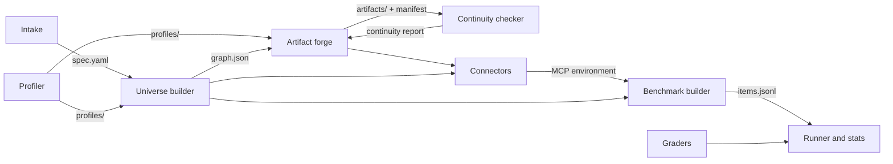

| Component | Takes | Makes | Use it alone to... |
|---|---|---|---|
| **Intake** | A description, a questionnaire, or pointers to a seed | `spec.yaml`, the universe spec | Turn a vague request into a precise world spec |
| **Profiler** | Open-source artifacts or a private seed (runs locally) | Structure profiles and mess profiles | Measure how a real corpus is shaped and how it is messy |
| **Universe builder** | A spec | `graph.json`: people, objects, events, timeline, knowledge | Get a consistent, simulated organization for any use |
| **Artifact forge** | A graph slice (or a one-line description, which gets a small graph made for it) and a file type | Files in native formats, with receipts | Generate realistic documents, threads, or records on their own |
| **Continuity checker** | Any set of artifacts plus a graph, or artifacts alone | A report of every claim: supported, tagged drift, contradiction, unsupported | Audit a synthetic corpus, including one Orbifex didn't make |
| **Connectors** | A universe, or a plain export (a Slack export, a Notion export) | MCP tools over live state, plus native exports | Give an agent a working Slack or Notion to test against |
| **Benchmark builder** | A universe and its environment | Items with gold outcomes, golden and silver trajectories, rubrics | Build evals on any world |
| **Graders** | Items and trajectories | Scores, with judge calibration reports | Grade runs from any harness |
| **Runner and stats** | Items, models or harnesses, trial count | Trials, pass@k, pass^k, intervals | Run and report evals reproducibly |

The rule that makes this work: **components talk only through files with schemas** (section [9](#9-files-data-model-and-layout)). No component reaches into another's internals.

---

## 3. Continuity: the method

Continuity is checked in five layers, from inside a file out to the whole world over time.

| Layer | Question | Example failure |
|---|---|---|
| **Within a file** | Does the file agree with itself? | The table total doesn't match the rows |
| **File to world** | Does every claim trace to the graph, or to tagged mess? | A contract names a client who doesn't exist |
| **Across apps** | Do files in different apps agree about the same facts? | The email says May 12, the Notion page says May 15 |
| **Over time** | Does the file respect what had happened, and what people knew, when it was written? | A Monday message mentions a decision made on Wednesday |
| **Person** | Does each person stay themselves: one identity, a consistent voice, their role, what they could know? | A junior analyst signs off on a budget only the CFO can approve |

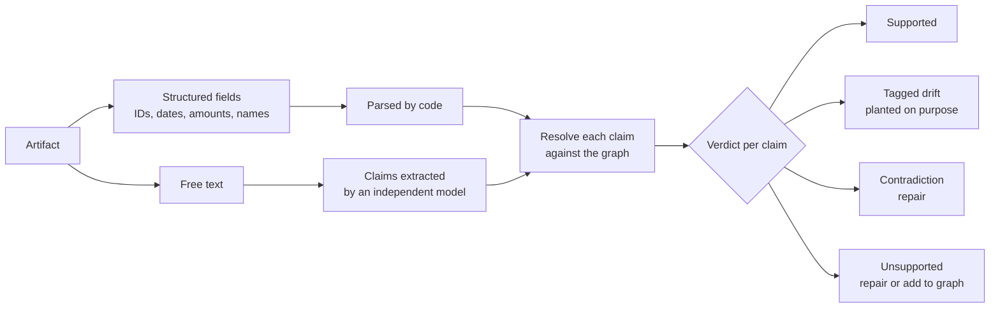

How it works:

1. **Split the artifact into claims.** Structured fields (IDs, dates, amounts, names, links) are parsed by code. Free text is broken into small, checkable claims by a model other than the maker, the way FActScore splits long answers into atomic facts ([2305.14251](https://arxiv.org/abs/2305.14251)) and SAFE checks each one ([2403.18802](https://arxiv.org/abs/2403.18802)).
2. **Resolve each claim against the graph** with code wherever possible: look up the entity, the value, and the time. A claim either matches, matches a tagged mess entry, contradicts the graph, or has nothing to match.
3. **Decide.** Contradictions are repaired. Unsupported claims are repaired, or, if they are harmless color ("the coffee machine is broken again"), added to the graph as minor facts so later files stay consistent with them.
4. **Check across apps.** For each event, gather every artifact it produced and check identity, references, timing, agreement, and access together.
5. **Report.** Every artifact gets a continuity receipt, and every universe gets a continuity report: claims checked, contradictions found and fixed, drift planted, and anything left.

The goal for a released universe is **zero untagged contradictions**. Tagged drift is expected and is part of what makes it realistic.

---

## 4. Artifact quality: the method

Each artifact passes six checks, cheapest first. Code runs first; an independent model runs second; people audit a sample.

| Check | Question | How |
|---|---|---|
| **Valid** | Does it open, parse, and look like the real format? | Code: parsers and schema validators per file type (a Slack export loads, an XLSX opens and its formulas compute) |
| **Faithful** | Does every fact trace to the graph or to tagged mess? | The claim method from section 3, within the file and against the graph |
| **Continuous** | Does it agree with every other artifact about the same facts? | Section 3, across apps and over time |
| **In voice** | Does it sound like its author, in the register of its medium? | An independent model compares it with the persona's profile and earlier writing; pairwise against exemplars |
| **Realistic** | Could it pass for a real one? | A blind judge tries to tell it from real examples of the same type; the target is near chance |
| **Novel** | Is it more than a copy of something already made? | Semantic near-duplicate search, unless the duplicate is deliberate and tagged |

Each file type adds its own checks: a spreadsheet's formulas recompute to the graph's figures; a contract's parties and dates match the graph; a transcript's speakers were in the meeting; a Slack thread's timestamps fall inside the event's window.

**Quality is also measured across the whole set,** because files that each pass can still add up to something unrealistic:

- **Shape:** lengths, formats, structure, and naming match the structure profile of real examples.
- **Mess:** the rate of each mess type matches the measured mess profile.
- **Variety:** diversity across the set, measured by clustering ([2410.15226](https://arxiv.org/abs/2410.15226)), stays close to real data, not collapsed into one style.
- **Human audit:** a random slice of each file type goes to a reviewer.

---

## 5. The agent loop

Every component runs the same loop. Only what the checkers ask changes.

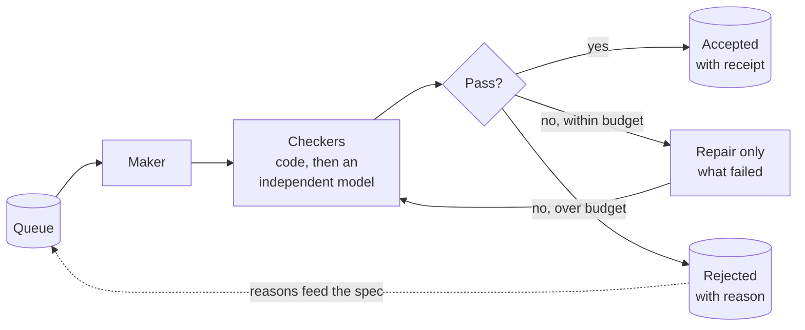

| Loop | What the checkers ask |
|---|---|
| Universe | Is the graph consistent: dates, sums, identities, knowledge over time? |
| Artifact | Is the file valid, faithful, continuous, in voice, realistic, and novel? |
| Connector | Does every app's state agree with the graph and with the other apps, except tagged drift? |
| Benchmark item | Is the gold right, the item solvable, realistically hard, and not gameable? |

The rules:

1. **The maker never marks its own work passed.**
2. **Repair is targeted and bounded.** Only failed checks rerun, for a fixed number of rounds; then the item is rejected honestly.
3. **Everything has a receipt:** each check's result, the models used, prompt hashes, seeds, and repairs.
4. **Coverage is declared.** The queue comes from the spec's grid, not from what the model likes to make.
5. **Loops run in parallel and survive crashes.** Workers claim items from a claims file.
6. **Rejections teach.** Rejection reasons are counted and fed back into the spec, the way reviewers' corrections refine a rubric (EvalGen).

In practice the makers and checkers are **Claude Code skills and subagents**, run headless. Any harness that can read files, run code, and call models can drive the same loop.

---

## 6. Method, component by component

### 6.1 Intake: three ways in

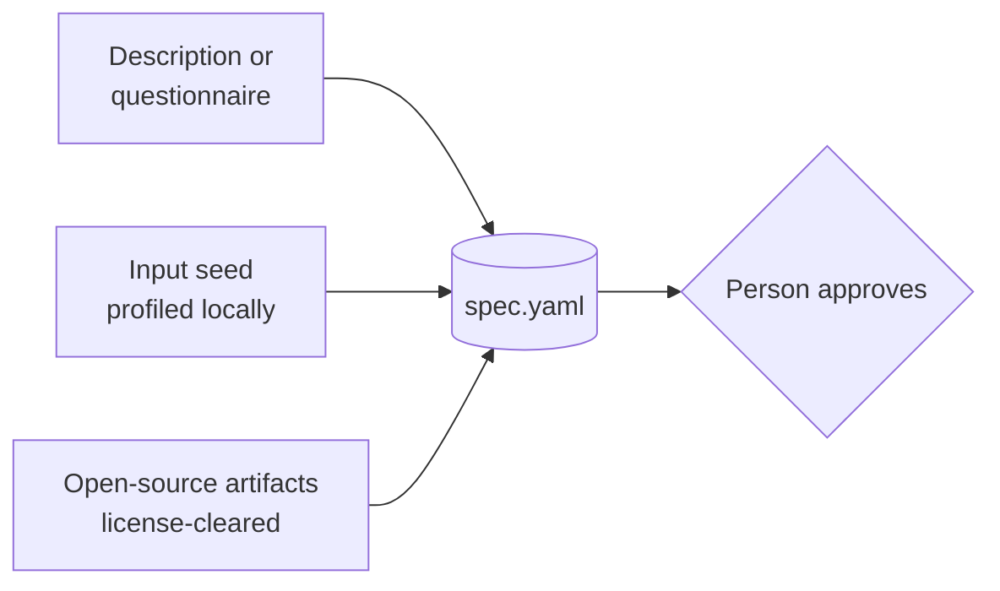

A universe is built around a **focal persona**. The questionnaire asks about them; blanks get sensible defaults.

| Topic | Asks about |
|---|---|
| Who | Role, seniority, what they own, what a good week looks like |
| Organization | Industry, size, stage, regions, era |
| Tools | Which apps they live in, and which app is the source of truth for what |
| People | Team, manager, clients, vendors; who they talk to most, and where |
| Work | Workstreams, deadlines, recurring meetings, busy seasons |
| Span and volume | A week, a quarter, or a year; roughly how many messages and files |
| Mess | How organized they are; where things go stale or get lost |
| Access | What is private, shared, or restricted, and to whom |
| Purpose (optional) | What agents should be tested on here |

A **seed** (a few real files, a CRM schema, an org chart) is profiled where it lives; only structure and statistics leave, never text. **Open-source artifacts** ground the world in real structure (section 6.2).

### 6.2 Profiler: real structure and real mess

Public, license-cleared sources (SEC filings, the Enron email corpus, public Slack and Discord exports, GitHub issues, open contracts and RFPs, public meeting transcripts) are recorded in a license ledger before anything is read. Profilers then produce:

- **Structure profiles:** what each document type looks like, and how documents reference each other.
- **Mess profiles:** the measured rate of each mess type, per file type and between files. The families to measure are versioning, duplication, conflict, omission, misplacement, format damage, human habits, access, and time ([research/07](research/07-messiness.md)).

### 6.3 Universe builder

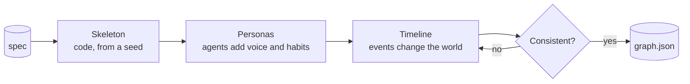

Code lays down organizations, people, and objects from the spec and a random seed, so the same seed rebuilds the same world. Agents give each person a voice, habits, and knowledge. A timeline simulator plays out events over the chosen span, each one changing the graph and recording which apps it should appear in. Checks cover dates, arithmetic, identities, and who knew what when. Size is a setting, from a week of one person's work to a year of a company, because small worlds flatter agents (CorporateBench).

### 6.4 Artifact forge

For each coordinate (file type, graph slice, author, mess operators), the forge pulls the structure profile, renders the file in the author's voice and the app's native format, applies mess at the measured rates with tags, and runs the checks in section 4. First wave: Slack, Notion, email, meeting transcripts, contracts and SOWs, spreadsheets, CRM records, tickets. Later: decks, calendars, code repositories (break a working repo so the fix is known, as in SWE-smith), scanned PDFs, audio.

Used alone, the forge takes a one-line description ("a Slack channel for a five-person agency during a client escalation"), builds the small graph it needs, and returns the files with their receipts.

### 6.5 Connectors

Each app is one connector with five parts:

| Part | Job |
|---|---|
| Schema | The app's objects and fields |
| Renderer | Writes its artifacts from the graph |
| Store | Typed state loaded from the universe |
| Tools | The app's operations over MCP, with its permissions, pagination, errors, and rate limits |
| Exporter | The app's native export format |

First: Slack, Notion, Gmail, Google Drive, Google Calendar. Then Linear, Jira, HubSpot, Salesforce, Zendesk, GitHub, Shopify, and meeting-transcript formats.

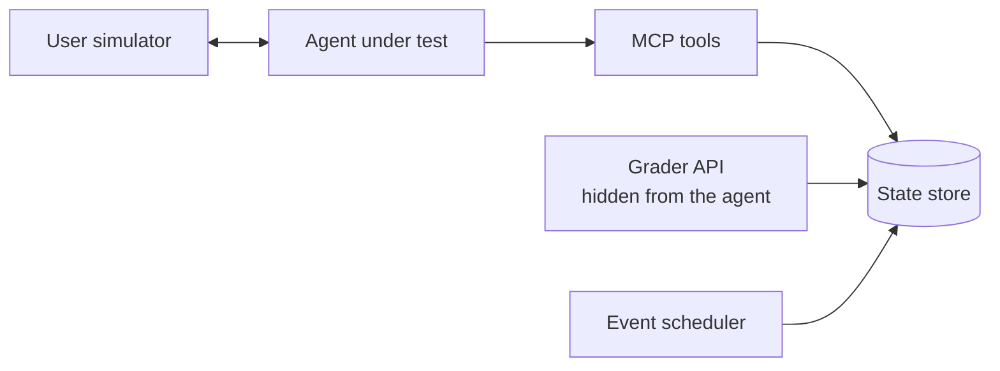

State lives in code; models write content only at build time, because simulated state breaks when several fields must change together (EnvSimBench). Graders read true state and the action log through an API the agent cannot reach. A persona with a hidden goal can play the user (τ-bench), and a scheduler lets time pass and messages arrive (ARE). Each run gets its own copy of the store. Prior art to study first: [Backlot](https://github.com/brekkylab/backlot), AppWorld, ARE/Gaia2.

---

## 7. Benchmarks: answers first

### 7.1 The premise and its limits

It is easier to build a hard problem while holding the answer than to solve it blind. A maker that constructs an item already knows its solution, because it planted the fact, broke the code, or wrote the record the question depends on. So every item is built backwards from its answer. The limits, all enforced:

1. **Knowing the answer isn't the same as it being right.** Gold is computed from the graph and re-derived by code, never just asserted. Items built to be hard fail audits more often, not less (Humanity's Last Exam).
2. **The maker's path is one valid path.** Grading rests on the outcome; trajectories supply checkpoints and forbidden actions, not a required sequence.
3. **Hard must be realistically hard.** Obscurity and trick wording are caught by the realism, shortcut, and counter-argument gates.

### 7.2 Ground truth by construction

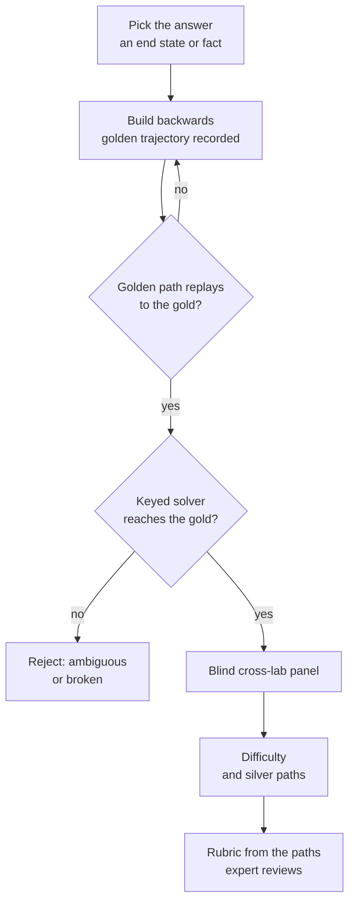

| Ground truth | What it is | Checked by |
|---|---|---|
| **Gold outcome** | The correct answer or end state, computed from the graph | Re-derived by code; a jury for free text |
| **Golden trajectory** | The maker's recorded path | Replayed in the environment |
| **Silver trajectories** | Verified successes by a **keyed solver** (holds the answer key, tests the item) and a **blind panel** (no key, tests the models) | The gold outcome |
| **Rubric** | Checkpoints every valid path shares (milestones), harmful actions blind solvers took (minefields), outcome criteria | An expert reviews and edits |

Grading order: the outcome first (exact answer, or state diff plus a check that nothing else changed), then milestones, then minefields, and a jury of model judges only for free text.

### 7.3 Recipes

| Recipe | Gold | Graded by |
|---|---|---|
| **Ground-truth answer** (questions across apps) | Query on the graph | Exact match; grounding in the right, current source |
| **Agentic decision** (act, ask, or stop) | The right action, from a minimal pair's one differing fact | The committing action; a minefield for the harmful one |
| **Environment task** (a goal across connectors) | Expected end state | State diff, milestones, no collateral damage |
| **Deliverable** (a memo, sheet, or deck) | Required facts and structure from the graph | Rubric tree; expert pairwise at the top |
| **Harness task** (spec to running software, e.g. Consul) | The spec's acceptance tests on the live app | End-to-end workflows, contract tests, trace checks |

Item gates, cheapest first: schema, gold recomputes, golden path replays, not answerable by shortcut, keyed solver succeeds, counter-argument, realism, novelty, blind panel difficulty, gameability probe (an impossible variant must fail).

### 7.4 Designing and running an eval

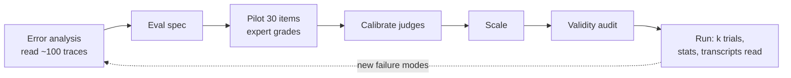

Start from failures, not metrics: an expert reads real traces, names and counts failure modes, and writes the construct. An eval spec is one versioned YAML file (universe, recipes, grid, mess, graders, human policy, split) from which any eval can be regenerated. Runs use an existing runtime (Inspect is the leading candidate, with Harbor or OpenEnv style task folders), one isolated environment per trial, and people read a sample of every run's transcripts.

---

## 8. Where people sit

| People are essential for | People are optional for |
|---|---|
| Approving each universe spec and each eval construct | Objective checks (schema, tests, state) |
| Writing rubrics by grading about 30 pilot items | Bulk filtering of candidates |
| Calibrating every judge (100 to 200 labels per failure mode) | Comparing systems over many items |
| Reviewing hard, frontier-failing items and disagreements | Structured fake records |
| Auditing random slices of artifacts, and answer keys, before release | |

In enterprise use, the customer's experts own the rubric, and their real data never enters the universe; only measured structure and mess do.

---

## 9. Files, data model, and layout

Components exchange these files:

| File | Contents |
|---|---|
| `spec.yaml` | Source, persona answers, grid, mess profile, size, seed |
| `graph.json` | Entities, events, timeline, knowledge, mess tags |
| `artifacts/` + `manifest.jsonl` | Each file with its app, type, source event, author, graph IDs, mess tags |
| `receipts.jsonl` | Every check result for every artifact and item |
| `continuity.json` | Claims checked, contradictions, drift, per artifact and per universe |
| `items.jsonl` | Recipe, payload, gold, golden and silver trajectories, rubric, difficulty, split, canary |
| `trials.jsonl` | Model or harness, config, trajectory, grades, cost, time |

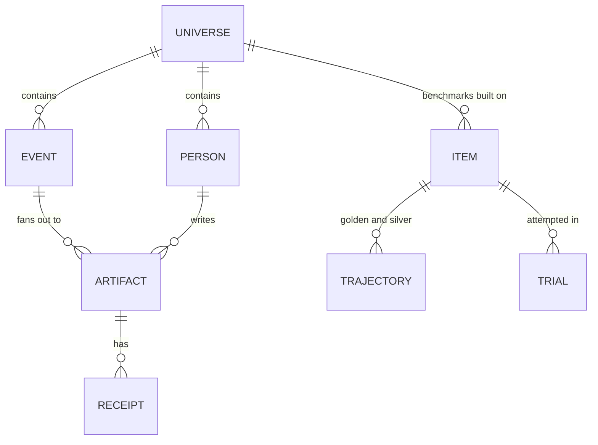

Proposed layout, for when code arrives:

```
orbifex/
├── README.md          # this design
├── research/          # findings that hold regardless of design
├── docs/              # animations and figures
├── specs/             # universe and eval specs
├── intake/            # questionnaire, intake agent, local seed profiler
├── profiler/          # open-source sources, license ledger, structure and mess profiles
├── universe/          # skeleton, personas, timeline, consistency
├── forge/             # artifact renderers per file type, mess operators
├── continuity/        # claim extraction, graph resolution, cross-app checks
├── connectors/        # one folder per app: schema, renderer, store, tools, exporter
├── environments/      # runtime, user simulators, event scheduler, grader API
├── benchmarks/        # recipes, backwards construction, solvers, rubric derivation
├── gates/             # shared checks, each returning a receipt
├── graders/           # exact, state diff, action oracle, tests, jury, pairwise
├── loop/              # the shared maker/checker loop, claims, repair, reflection
├── runner/            # runtime adapter, trial isolation, statistics
├── review/            # review queue, sampling, escalation
└── .claude/           # skills and subagents that drive the loops
```

---

## 10. Metrics, release, and contamination

| Metric | Definition |
|---|---|
| **Continuity** | Share of claims supported or tagged; target zero untagged contradictions |
| **Realism** | How often a blind judge can tell an artifact from real examples; target near chance |
| **Fidelity** | Share of an artifact's claims that trace to the graph |
| **pass@k** | Probability at least one of k attempts succeeds (capability) |
| **pass^k** | Probability all k attempts succeed (reliability) |
| **Item difficulty** | Panel solve rate, plus an item response theory fit |
| **Judge quality** | True positive and true negative rates against human labels |

Headline numbers carry clustered 95% intervals; models are compared with paired differences; power is checked before claiming a gap. Releases use public, held-out, and private splits, canary strings in every file, semantic deduplication, fresh universe seeds, and a public errata log.

---

## 11. Build order and next steps

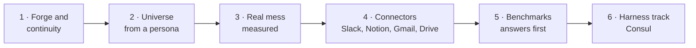

The forge and the continuity checker come first because they are useful on their own and everything else depends on them.

Next steps:

1. Write the persona questionnaire and pick the first focal persona (a solo founder or small agency owner: rich in Slack, Notion, email, and client documents, and small enough to build).
2. Write the first universe spec from the answers, before any code.
3. Build the continuity checker against a hand-made mini world: a dozen artifacts with planted contradictions and planted drift, so its accuracy can be measured before it judges anything else.
4. Measure mess for Slack, email, and spreadsheets from open sources.
5. Review Backlot and Kiln (prior art in [research/09](research/09-adjacent-tools.md)).
6. Settle the runtime, and decide what existing private work can move in, which also decides when this repo goes public.

---

## 12. Open questions

- How realistic is realistic enough? A blind judge is one test; agreement between model rankings on a synthetic world and on a partner's real data is the stronger one.
- How big must a universe be before scale effects show?
- How do several evals share one universe without leaking answers?
- How much should the user simulator vary, given scores swing by up to 9 points across simulator models ("Lost in Simulation")?
- Where does the enterprise version run: on the customer's machines, ours, or both?

---

Research notes: [`research/`](research/README.md) · Bibliography: [`research/bibliography.md`](research/bibliography.md)
