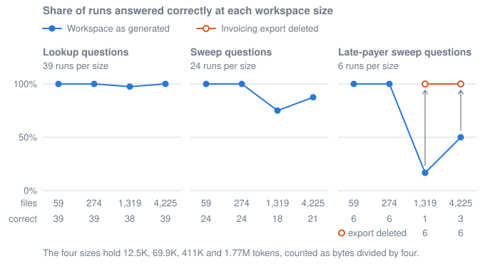

# Orbifex

Orbifex is a standard-library Python program that turns a description of one fictional person into a seeded workspace of mail, calendar, files and five app exports at four sizes, with the answer to every question fixed before any file is written. It checks that each answer can be recovered from the files alone and exports each question as a task for [Harbor](https://github.com/harbor-framework/harbor) 0.26.0, so an agent can be asked the same question in a workspace of 59 files and in one of 4,225.

I ran a small pilot with one model (`claude-haiku-5-5`), one persona and one seed. On the eight-source version of the workspace the model answered 242 of 252 runs correctly. Making the workspace 141 times larger in tokens, from 59 files to 4,225, cost one answer in 156 on lookup questions, which keep the same wording and answer at every size (155 of 156 correct). A sweep question covers every client in a month, and the sweep that asks who paid late accounts for 8 of the 10 misses. All 8 have one cause, an invoicing export that still showed due dates an email had since extended. Deleting that export at the two largest sizes moved that question from 4 of 12 runs correct to 12 of 12.

<p align="center">
  
</p>

Each point is the share of runs answered correctly at one workspace size, and the rows under each panel give the counts. The open circles are the late-payer runs repeated after the `invoicing/` folder was deleted. [`scripts/make_readme_figure.py`](scripts/make_readme_figure.py) draws the figure from the run records.

## How do I run it?

The generator, the tests and the reproduce script need Python 3.11 or newer and no packages. The three `harbor` commands need Harbor 0.26.0, which itself needs Python 3.12 or newer, and the two `harbor run` commands also need Docker.

```bash
git clone https://github.com/nbdesai1992/orbifex && cd orbifex

# Python 3.11 or newer, standard library only, nothing to install
PYTHONPATH=src python3.11 -m orbifex.cli ladder personas/cpa-solo.toml --seed 7 \
    --out build/cpa --workspace --harbor datasets
python3.11 -m unittest discover -s tests

# Harbor 0.26.0
harbor lint --extend-select ALL datasets/cpa-solo-t*/*/

# Harbor 0.26.0 and Docker
harbor run -p datasets/cpa-solo-t3 -a oracle     # the reference solver, every reward should be 1
harbor run -p datasets/cpa-solo-t3 -a nop        # an agent that does nothing, every reward should be 0
```

The `ladder` command takes about ten seconds. It writes each size's files to `build/cpa/t1/workspace/` through `t4`, puts a check report, a manifest and the questions with their answers beside them, and writes one Harbor task folder per question under `datasets/cpa-solo-t1/` through `t4`. If any check fails it stops with an error and exports nothing.

The code and the result files call the four sizes tiers 1 to 4, call lookup questions needle tasks, and give them the scope `core`.

## How does it work?

The facts are decided first and the files are written from them, which is what gives a workspace that never existed an answer key.

1. A persona pack is about 300 lines of TOML that names one person, their clients, what the work is called and how they write. Two packs ship, a solo accountant ([`personas/cpa-solo.toml`](personas/cpa-solo.toml)) and an independent designer on monthly retainers ([`personas/studio-retainer.toml`](personas/studio-retainer.toml)).
2. [`world.py`](src/orbifex/world.py) turns a pack and a seed into a table of facts. The final value of every fact comes from a random stream keyed by seed, client and month, which the size setting never touches, so a question has one answer at every size.
3. [`render.py`](src/orbifex/render.py) writes the facts out as files and records which facts each file or message states and whether each statement is still current. The smallest size has mail and a calendar. The second adds a drive and bank statements, the third adds a Slack export, an invoicing app and a time tracker, and the fourth adds a retailer's order history. From the third size on, the workspace also keeps the superseded versions of facts that were later corrected. The invoicing app is out of date on purpose and keeps each invoice's original due date after an extension agreed by email.
4. [`tasks.py`](src/orbifex/tasks.py) builds 47 questions per size from the table, 188 in all. The 39 lookup questions ask about the same three clients, one at a time or together, or about one order, and they keep their wording and answer at every size. The 8 sweep questions cover every client or every order in a month, so their answers grow with the workspace. Each question carries the wrong answers a careless reader would give, such as a total taken from an invoice that was later corrected.
5. [`checks.py`](src/orbifex/checks.py) blocks export unless a second solver ([`oracle.py`](src/orbifex/oracle.py)), which reads only the rendered files, recovers every answer. The grader must also reject every predicted wrong answer, no file may name the generator or the key, and every recorded statement must be found in its file's text.
6. [`harbor.py`](src/orbifex/harbor.py) writes one self-contained Harbor task per question, with a separate verifier, base images pinned by digest and a non-root agent. Grading is an exact comparison after normalizing amounts, letter case and list order, with no model in the grading path.

Files that differ between tasks and sit in a Docker build context carry a hash of their content in their names. An earlier export used fixed names, and Docker graded some tasks with another task's answer key once an archive had flattened the timestamps. The [changelog](CHANGELOG.md) entry for 2026-11-16 and section 4.4 of the paper describe the fault.

## What did the pilot measure?

Claude Haiku 5.5 (`claude-haiku-5-5`) ran through Claude Code's headless mode with four tools (Read, Grep, Glob and Write) and no shell, web access or MCP servers, on a private copy of each size's workspace. Each lookup question ran once per size and each sweep question three times, and the verifier that ships in the Harbor task graded every answer. The pilot script passed the alias `haiku`, and the `model_ids` field of every record shows that Claude Code resolved it to `claude-haiku-5-5`.

<!-- results-table:start -->
|  | Size 1 | Size 2 | Size 3 | Size 4 |
|---|---:|---:|---:|---:|
| Files in the workspace | 59 | 274 | 1,319 | 4,225 |
| Tokens (bytes divided by four) | 12,537 | 69,864 | 410,678 | 1,768,853 |
| Sources | 2 | 4 | 7 | 8 |
| Lookup questions correct, of 39 runs | 39 | 39 | 38 | 39 |
| Sweep questions correct, of 24 runs | 24 | 24 | 18 | 21 |
| Late-payer sweep question correct, of 6 runs | 6 | 6 | 1 | 3 |
| The same question with `invoicing/` deleted, of 6 runs | not run | not run | 6 | 6 |
| Mean cost of a lookup run, US cents | 0.9 | 1.0 | 1.1 | 1.3 |
| Mean cost of a sweep run, US cents | 1.0 | 1.5 | 1.5 | 5.3 |
<!-- results-table:end -->

In total the model answered 155 of 156 lookup runs and 87 of 96 sweep runs. The workspace grew from 12,537 to 1,768,853 tokens, and over that range the mean cost of a lookup run rose from 0.9 to 1.3 cents. A lookup answer needs a mean of 2.21 facts at every size. A sweep answer needs more facts as clients and orders are added, a mean of 4.25 at the smallest size and 27.62 at the largest, and the mean cost of a sweep run rose from 1.0 to 5.3 cents. Claude Code reported $3.89 for 252 runs and $0.66 for 12 runs of the ablation.

The late-payer sweep question asks which clients paid an invoice after its final due date, for each of two months. At the two largest sizes some due dates are extended in an email reply, and the invoicing export still lists the original date. All 8 wrong answers equal the list computed from original due dates, which the generator had written down as a predicted wrong answer before any run. With the `invoicing/` folder deleted from the workspace, the same questions went from 4 of 12 to 12 of 12. The other two misses were a lookup question about a total invoiced and a sweep over one month's orders, both at the third size.

An earlier version of the dataset had four sources and 164 tasks, and the same model answered 210 of 212 runs on it. Its records are in [`experiments/results/cpa-solo-seed7/`](experiments/results/cpa-solo-seed7/), and the records behind the table are in [`experiments/results/cpa-solo-seed7-v2/`](experiments/results/cpa-solo-seed7-v2/).

## Why are there two sets of policy rates?

The generator also scores two simulated careless readers on every question, with no model involved. The first-hit policy trusts the top BM25 hit for each fact a question needs, and the latest-wins policy trusts the most recently dated file that states it. `ladder.json` holds each rate over all 47 questions of a size, because [`checks.measure`](src/orbifex/checks.py) averages over every task. The paper and earlier versions of this README quote the rates over the 39 lookup questions only, which is how `paper/make_figures.py` computes them. Both sets come from the same per-question records in `report-t<size>.json` and differ only in which questions are counted.

<!-- policy-table:start -->
|  | Size 1 | Size 2 | Size 3 | Size 4 |
|---|---:|---:|---:|---:|
| First-hit, lookup questions only (39 per size) | 100.0% | 100.0% | 69.2% | 48.7% |
| Latest-wins, lookup questions only (39 per size) | 100.0% | 100.0% | 69.2% | 66.7% |
| First-hit, all questions (47 per size) | 100.0% | 100.0% | 68.1% | 46.8% |
| Latest-wins, all questions (47 per size) | 100.0% | 100.0% | 61.7% | 59.6% |
<!-- policy-table:end -->

Both policies predicted a harder workspace than the model met. At the largest size the first-hit policy solves 48.7% of lookup questions and the model answered 39 of 39.

## How do I reproduce the numbers?

```bash
scripts/reproduce.sh python3.11
```

The script takes the Python interpreter as its argument and needs `curl` and `tar`. It regenerates the seed-7 dataset in a temporary folder with the `ladder` command above, prints one sha256 for the generated task tree, downloads and unpacks the published archive, compares the two trees file by file, compares the regenerated check reports with the committed ones, and prints both tables and the headline numbers on this page from the JSONL files. It calls no model and takes under a minute.

On 2026-11-26 the regenerated tree was file for file identical to the published [`cpa-solo-harbor-v2.tar.gz`](https://nealdes.ai/assets/orbifex/cpa-solo-harbor-v2.tar.gz). Both hold 2,256 files under the four `cpa-solo-t*` folders and give this tree checksum.

```
25228b794204f9e84216952ec6fc75b49d4a405bce27d883177a9876fd5f946f
```

I got the same checksum with Python 3.11.10 on macOS and with Python 3.11.18 and 3.13.18 in Linux containers. The checksum covers file paths and contents, and [`scripts/tree_sha256.py`](scripts/tree_sha256.py) shows how to get it with `shasum` alone. The archive holds one more file, its own `README.md`, which the generator does not write. The archive file itself had sha256 `339e7731134ff23817af1509e0ea615406b01ce977b2d9dbba8ed2aadea28153` on that day.

The tests hold this page to the data. `python3.11 -m unittest discover -s tests` fails if either table, a headline number or the figure differs from what [`scripts/results_table.py`](scripts/results_table.py) counts in the records.

Running the model again is a separate step that costs money. [`experiments/claude_pilot.py`](experiments/claude_pilot.py) needs Claude Code, bills its account and defaults to `claude-haiku-5-5`. To repeat the ablation, delete `t3/workspace/invoicing` and `t4/workspace/invoicing` from a copy of the build folder and run the two `sweep-late` questions at those sizes with `--trials 3`. Counts will move between runs. In the records, one late-payer question at the third size was answered correctly in one of its three trials and wrongly in the other two.

## What does the evidence not cover?

1. The pilot used one model, `claude-haiku-5-5`, with search tools. No run had to fit a workspace into its context window, and no other model or harness was tried.
2. It used one seed and one persona. The designer pack passes the same checks in the tests, and no model has been run on it.
3. Each lookup question ran once per size, which gives 39 runs per size. Each sweep question ran three times, which gives 24 runs per size and 6 for the late-payer question.
4. The tables give counts without intervals. The paper adds a 95% Wilson interval for the lookup error rate (0.1% to 3.5%) and a two-sided Fisher exact test for the ablation (p = 0.001), and `scripts/results_table.py --facts` recomputes both.
5. The ablation is 12 runs. It deleted one folder at two sizes and reran one kind of question. The paper records that nothing else was changed, and the repository holds the 12 run records and no script for the deletion.
6. The comparison with the four-source version is across two versions of the dataset and is not a controlled experiment.
7. Text comes from templates, so it reads cleaner than real mail. Tasks are read-only, both personas share one monthly cycle of request, documents, meeting, invoice and payment, and the invoicing export is the only app that lags.
8. The four sizes were set by construction and have not been calibrated against a measured pass rate.
9. `harbor lint` with every rule enabled reported nothing on the 188 regenerated tasks under Harbor 0.26.0 on 2026-11-26. The paper records that Harbor's oracle scored 1 and its no-op agent 0 on all 188 tasks from an unpacked archive, and this repository holds no log of those runs.

## Where is everything?

- [Part 1, the anatomy of an agent eval](https://nealdes.ai/articles/harbor-format), explains the Harbor task format.
- [Part 2, what makes a workspace hard for an AI agent](https://nealdes.ai/articles/persona-to-environment), is the illustrated write-up of this work.
- [The paper](https://nealdes.ai/assets/orbifex/orbifex-paper.pdf) has the method and results in one place. Its source is in [`paper/`](paper/), and its two data figures are also in `docs/` as [`paper-results.svg`](docs/paper-results.svg) and [`paper-tiers.svg`](docs/paper-tiers.svg).
- [`cpa-solo-harbor-v2.tar.gz`](https://nealdes.ai/assets/orbifex/cpa-solo-harbor-v2.tar.gz) is the eight-source dataset of 188 tasks, and [`cpa-solo-harbor.tar.gz`](https://nealdes.ai/assets/orbifex/cpa-solo-harbor.tar.gz) is the earlier four-source dataset of 164 tasks.
- [harbor-inspect](https://github.com/nbdesai1992/harbor-inspect) is a companion tool that prints what is inside any Harbor task and flags the build-context fault.
- [`experiments/results/`](experiments/results/) holds every run record, 616 in all.
- [`docs/design.md`](docs/design.md) is the design history, the document this repository started with on 2026-09-27.
- [`research/`](research/README.md) holds the reading notes and bibliography behind that design.
- [`CHANGELOG.md`](CHANGELOG.md) dates each step from the design to this page.

## How do I cite it?

[`CITATION.cff`](CITATION.cff) has the details, and GitHub's "Cite this repository" button reads it. The paper is a preprint that has not been peer reviewed.

```bibtex
@misc{desai2026orbifex,
  author       = {Desai, Neal},
  title        = {Orbifex: Synthetic Workspaces from a Persona, with Answer-Preserving Complexity Tiers},
  year         = {2026},
  howpublished = {\url{https://nealdes.ai/assets/orbifex/orbifex-paper.pdf}},
  note         = {Preprint. Code at \url{https://github.com/nbdesai1992/orbifex}}
}
```
