# Demiurge

**Worlds for evals. Built by agents, checked by everything else.**

Demiurge is a design for a synthetic data engine. It builds **universes**: cohesive, believable worlds around a person or a company, with the people, clients, projects, and history, and every Slack thread, Notion page, email, contract, spreadsheet, and ticket that world would produce. It serves that world through **synthetic connectors** (Slack, Notion, Gmail, Drive, and more) that agents can use as tools. And it turns the world into **benchmarks** with trustworthy answers.

Think of it as a flight simulator for AI agents doing office work: a believable place to operate in, and, when you want one, an answer key.

Claude Code, or any agentic harness, does the making. Code, independent models, and people do the checking.

> **Status: design only.** This repo holds the design and the research behind it, so the design can change quickly. No engine code yet. The research in [`research/`](research/) stands on its own and applies whichever design we pick.

The name is a working title. See [Naming](#naming).

---

## Contents

1. [What it makes](#1-what-it-makes)
2. [Principles, layer by layer](#2-principles-layer-by-layer)
3. [Scope](#3-scope)
4. [The system at a glance](#4-the-system-at-a-glance)
5. [Starting a universe: three ways in](#5-starting-a-universe-three-ways-in)
6. [Building the universe](#6-building-the-universe)
7. [Generating artifacts](#7-generating-artifacts)
8. [Synthetic connectors and cohesion](#8-synthetic-connectors-and-cohesion)
9. [Benchmarks and evals](#9-benchmarks-and-evals)
10. [The agentic loop every layer shares](#10-the-agentic-loop-every-layer-shares)
11. [Where humans sit](#11-where-humans-sit)
12. [Data model](#12-data-model)
13. [Repository layout](#13-repository-layout)
14. [Metrics and statistics](#14-metrics-and-statistics)
15. [Contamination and release](#15-contamination-and-release)
16. [Build order and next steps](#16-build-order-and-next-steps)
17. [Open questions](#17-open-questions)
18. [Naming](#naming)

---

## 1. What it makes

One universe, three things you can take away from it. Each is useful on its own.

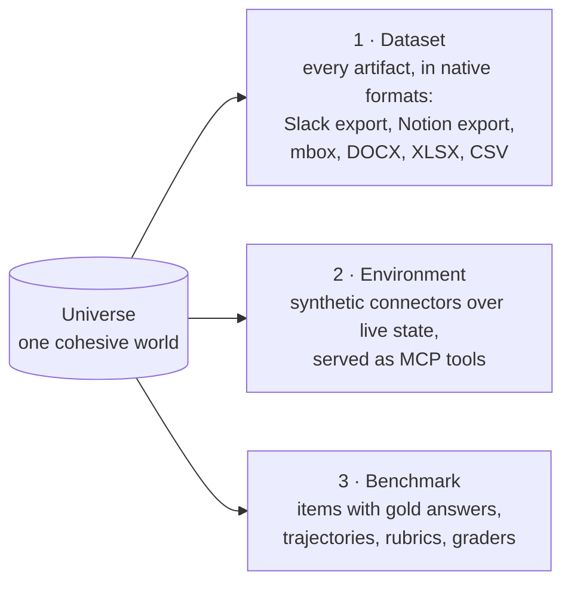

1. **Dataset.** The universe exported as files in each tool's native format, for retrieval evals, demos, testing ingestion pipelines, or seeding other systems.
2. **Environment.** The same world behind working tools, so an agent can search Slack, read Notion, send email, and update a CRM, and every action changes real state.
3. **Benchmark.** Items built on the world: questions, tasks, decisions, deliverables, and harness tasks, each with verified ground truth and graders.

## 2. Principles, layer by layer

Each layer has its own job, so each has its own principles, drawn from the literature and practitioner canon in [`research/`](research/). A few hold everywhere.

### 2.1 Everywhere

1. **Trust is the product, and volume is cheap.** A model can write a thousand files or eval items in an afternoon; the hard part is proving they are right. Audits of famous benchmarks keep finding errors (about 59% of audited SWE-bench Verified failures had flawed tests; roughly 30% of Humanity's Last Exam chemistry and biology answers look wrong). Every output carries receipts: what made it, what checked it, and what passed.
2. **The maker never approves its own work.** Checks are done by code, or by a model other than the maker, and nothing is graded by its author alone. LLM-built benchmarks rank their own author first ("When LLMs Benchmark Themselves", 2025).
3. **Diversity is designed, not sampled.** Models converge on each other's outputs ("Artificial Hivemind", NeurIPS 2025), so switching vendors buys little. Variety comes from a declared grid: personas, roles, document types, audiences, and mess profiles. (Persona Hub, DataMorgana, Cosmopedia.)
4. **Real mess is measured, then reproduced.** Real data is full of stale versions, conflicting numbers, misfiled documents, half-filled fields, and near-duplicates, and agents fail on exactly those. We measure that mess in real artifacts and reproduce it on purpose, tagged so nothing downstream mistakes it for an error.
5. **People own the definition of quality.** Criteria drift once you look at real outputs ("Who Validates the Validators?"). Experts write and revise rubrics by grading samples and calibrate every automated judge.
6. **Keep the pool, add to it.** Versioned and append-only, with provenance on everything. (Accumulate, don't replace: Gerstgrasser et al. 2024.)

### 2.2 Universe

1. **The world comes first; everything else is a view of it.** A typed, time-stamped graph (people, organizations, projects, contracts, decisions, events) is the source of truth. Every artifact is rendered from it and every answer is computed from it. (CorporateBench, Era by Eon, HERB, EntiGraph.)
2. **Cohesion is the point.** One decision made in a meeting should show up in the transcript, the Slack follow-up, the Notion page, and the updated contract, with realistic lag, and sometimes realistic inconsistency. A world that only hangs together inside one app is not a universe.
3. **Built around a persona.** A universe starts from someone: a solo founder, a sales lead, a support manager. Their role, tools, and collaborators decide what exists. Persona conditioning is also the strongest source of variety.
4. **Deterministic skeleton, generative detail.** Code lays down the structure from a spec and a seed, so the same seed rebuilds the same world. Agents add voice and texture.
5. **Time and knowledge are first-class.** Events happen in order and change the world; the graph records who knew what, and when.
6. **Size is a setting.** Small worlds flatter models (CorporateBench finds performance drops as a corpus nears realistic scale). Universes come in sizes, from a week of one person's work to a year of a company.

### 2.3 Artifacts

1. **Grounded in real structure.** What a real SOW, board update, Slack channel, or Notion wiki looks like is learned from real, license-cleared examples, not imagined. (AgentInstruct, Genie.)
2. **Faithful to the world.** Every fact in a file traces to the graph, or is a tagged, deliberate piece of mess.
3. **Written in the author's voice.** A file sounds like the persona who wrote it, in the register of its medium: terse in Slack, formal in a contract.
4. **Gated for fidelity and realism, not difficulty.** Artifacts are not puzzles. Their gates ask whether the file is valid, faithful, consistent across apps, in voice, realistic, and not a duplicate. Difficulty belongs to the benchmark layer.
5. **Native formats.** A Slack export looks like a Slack export. Files open in the tools they claim to come from.

### 2.4 Connectors

1. **State lives in code; models write content.** Each connector reads and writes a typed store loaded from the universe. Models write message bodies and pages at build time and never own the state, because simulated state breaks when several fields must change together (EnvSimBench's "state change cliff"). (AppWorld, τ-bench, ARE.)
2. **One universe behind every app.** The same people, IDs, and threads appear in Slack, Notion, Gmail, and the CRM, so real tasks require working across apps.
3. **Realistic edges.** Each connector mirrors its real API's shape, permissions, pagination, errors, and rate limits. Happy-path mocks inflate scores (ToolSandbox, EnterpriseBench).
4. **A hidden side for grading.** Graders read true state and the action log through an API the agent cannot reach.
5. **Standard delivery.** Tools are served over MCP, so any agent or harness can plug in.

### 2.5 Benchmarks

**The premise: build it backwards.** For eval items specifically, it is easier to build a hard problem while holding the answer than to solve it from scratch without one. A maker that constructs an item already knows its solution, because it planted the fact, broke the code, or wrote the record the question depends on. A model under test starts blind. The benchmark layer is built on that asymmetry between generation and verification (AutoBencher's privileged information, instruction backtranslation, SWE-smith, planted discrepancies).

This premise is for eval design. Generating a Slack conversation or a contract does not need it; those are judged on fidelity and realism (2.3).

It has three limits, and the design enforces each:

1. **Knowing the answer is not the same as the answer being right.** A maker's gold can be wrong if the world is inconsistent, and items built to be hard fail audits more often, not less. Gold is computed from the graph and independently re-derived, never just asserted.
2. **The maker's path is one valid path, not the only one.** The golden trajectory is a reference. Grading rests on the outcome; trajectories supply checkpoints and forbidden actions, not a required sequence.
3. **Hard has to be realistically hard.** Obscurity, trick wording, and unresolvable contradictions are not difficulty. Realism, shortcut, and counter-argument gates catch them.

And the rest of the benchmark principles:

4. **Construct backwards, verify forwards.** Record the maker's construction as the golden trajectory; confirm with independent solvers, with and without the answer key (section 9.2).
5. **Use the cheapest grader that can be right.** Exact match, state diffs, and tests first; a mixed-family jury of model judges for free text; people last. Each judge has its own labeled test set.
6. **Difficulty is measured.** A cross-lab panel attempts every item. Items that do not separate models, or that a shortcut answers, are dropped. Item response theory places items on a scale.
7. **Every claim carries error bars.** pass@k and pass^k over at least four trials, clustered intervals, and a power check before claiming a gap.
8. **Contamination is a lifecycle.** Canaries, semantic dedup, public, held-out, and private splits, fresh seeds, and errata.

## 3. Scope

**In scope:** universes built from a description, a seed, or open-source artifacts; artifact generation across many file types; synthetic connectors with cross-app cohesion; benchmarks and eval environments; evaluating agent harnesses, starting with [Consul](https://github.com/nbdesai1992/consul).

**Out of scope, for now:** post-training. The same universes and graders could later produce training data and rewards, but that belongs in a separate cookbook with different bars (above all, resistance to reward hacking). Keeping every grader callable on its own leaves that door open.

## 4. The system at a glance

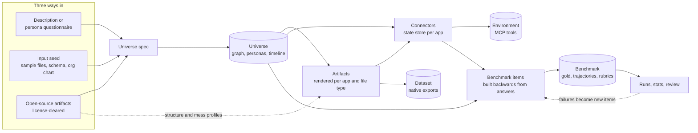

## 5. Starting a universe: three ways in

All three produce the same thing, a **universe spec**, and can be combined: a description for the persona, a seed for the real structure of their data, and open-source artifacts for how documents look and how they are messy.

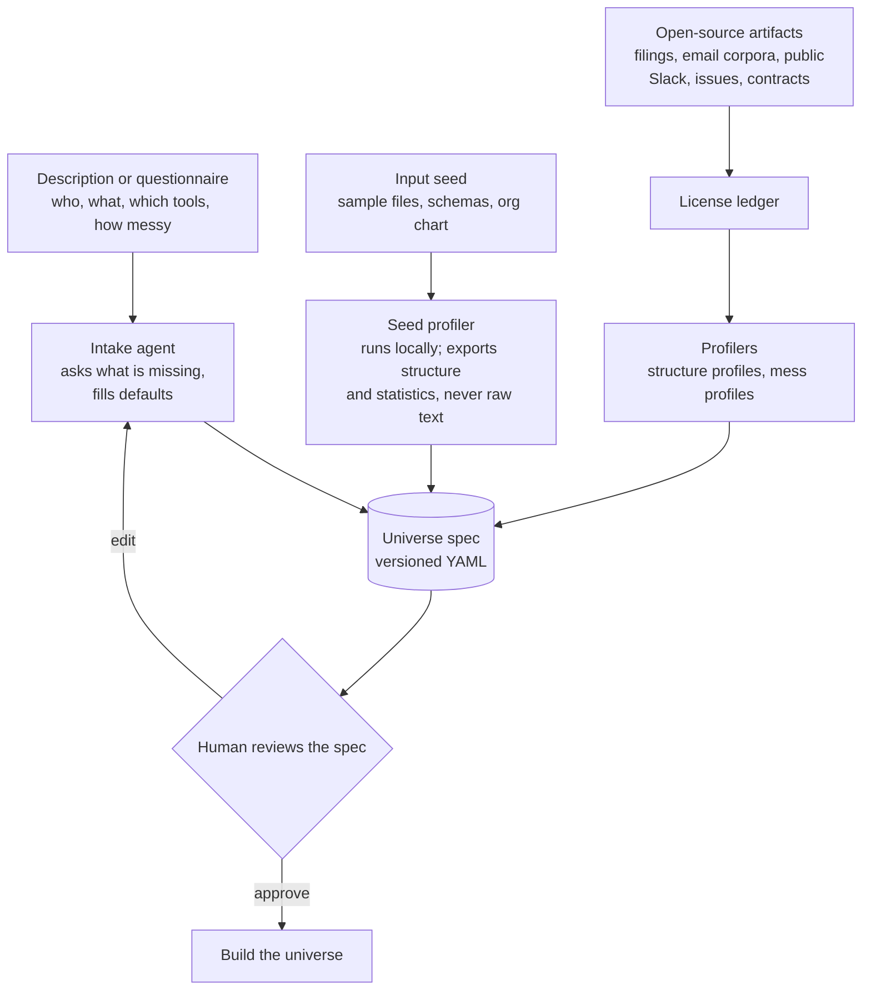

### 5.1 From a description or questionnaire

A universe is built around a **focal persona**. The intake asks about them, and the answers become the spec. Anything left blank gets a sensible default.

| Topic | Example questions |
|---|---|
| **Who** | Role and seniority? What do they own? What does a good week look like? |
| **Organization** | Industry, size, stage, regions, era? Solo, team, or company? |
| **Tools** | Which apps do they live in (Slack, Notion, Gmail, Drive, Calendar, Linear, HubSpot, GitHub, Shopify)? Which is the source of truth for what? |
| **People around them** | Team, manager, clients, vendors, investors? Who do they talk to most, and where? |
| **Work** | Main workstreams (deals, projects, support cases, launches)? Busy seasons, deadlines, recurring meetings? |
| **Span and volume** | A week, a quarter, or a year? Roughly how many messages, pages, and files? |
| **Mess** | How organized are they? Where do things go stale or get lost? |
| **Access and sensitivity** | What is private, shared, or restricted, and to whom? |
| **Purpose** (optional) | What should agents be tested on in this world? |

### 5.2 From an input seed

A customer or partner provides samples: a few real files, a CRM schema, an org chart, a folder structure. A profiler runs where the data lives and exports only structure and statistics: field shapes, document types and lengths, naming habits, how files reference each other, and mess rates. The universe is built to match, and no real text enters it.

### 5.3 From open-source artifacts

Public, license-cleared material grounds the world in real structure: SEC filings and exhibits, the Enron email corpus, public Slack and Discord exports, GitHub issues and pull requests, open contracts and RFPs, public meeting transcripts. Every source gets a license and allowed-use entry before it is read. Profilers extract:

- **Structure profiles:** what each document type looks like and how documents cite each other.
- **Mess profiles:** measured rates of each kind of real-world mess, per file type and between files.

The mess families to measure (a hypothesis until measured; see [research/07](research/07-messiness.md)): versioning, duplication, conflict, omission, misplacement, format damage, human habits, access, and time.

## 6. Building the universe

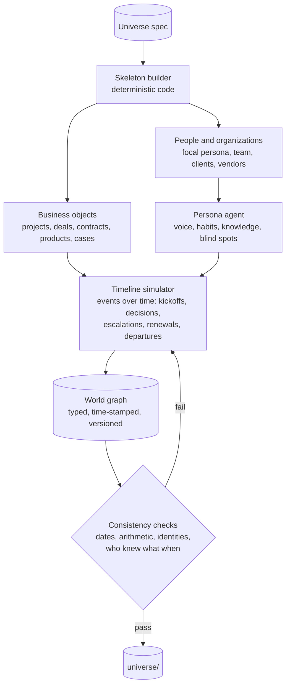

- **Skeleton from code.** Organizations, people, and objects, laid down from the spec and a seed.
- **Personas from agents.** Each person gets a voice, habits (terse, over-explains, replies at midnight), what they know, and when they learned it.
- **Events over time.** Each event changes the graph and records which apps it should appear in. A price change in March; a contact leaving in May; a decision in Tuesday's meeting.
- **Consistency checks.** Dates in order, sums that add up, one identity per person across apps, and knowledge that respects time.

## 7. Generating artifacts

Artifacts are rendered from the graph, one loop per file. Their checks are about fidelity and realism.

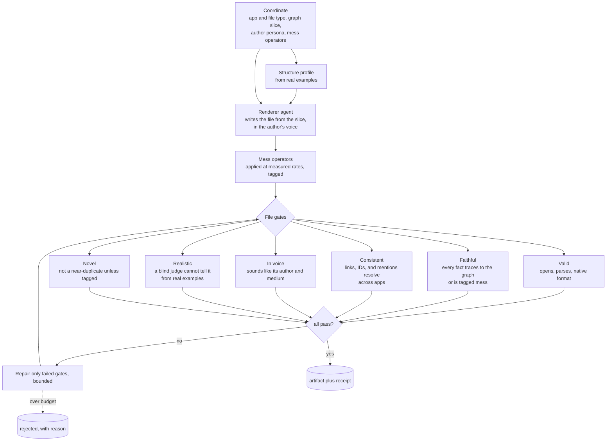

File types, first wave and later:

| First wave | Later |
|---|---|
| Slack channels and DMs, Notion pages and databases, email threads, meeting transcripts, contracts and SOWs (DOCX/PDF), spreadsheets with formulas (XLSX), CRM records, tickets | Slide decks, calendars, code repositories (break a working repo, SWE-smith style), scanned PDFs, wiki spaces, audio |

Each renderer adds its own gates: a spreadsheet's formulas recompute to the graph's figures; a contract's parties and dates match the graph; a transcript's speakers were in the meeting; a Slack thread's timestamps sit inside the event's window.

## 8. Synthetic connectors and cohesion

### 8.1 What a connector is

Every supported app is one connector, with five parts:

| Part | Job |
|---|---|
| **Schema** | The app's objects and fields (Slack: workspaces, channels, messages, threads, reactions; Notion: pages, blocks, databases, properties) |
| **Renderer** | Writes that app's artifacts from the graph (section 7) |
| **Store** | A typed state store loaded from the universe |
| **Tools** | The app's operations over MCP, with its permissions, pagination, errors, and rate limits |
| **Exporter** | Writes the app's native export format for the dataset |

Starting catalog:

| Category | Apps |
|---|---|
| Chat | Slack (first), Microsoft Teams, Discord |
| Docs and wiki | Notion (first), Google Docs, Confluence |
| Mail and calendar | Gmail and Google Calendar (first), Outlook |
| Files | Google Drive (first), Dropbox, a plain filesystem |
| Work tracking | Linear, Jira, Asana |
| CRM and support | HubSpot, Salesforce, Zendesk |
| Code | GitHub |
| Commerce and finance | Shopify, Stripe, QuickBooks-style ledgers |
| Meetings | Transcripts in Zoom, Google Meet, and Fireflies formats |

Prior art to study before building: [Backlot](https://github.com/brekkylab/backlot), a local emulator for Slack, Gmail, and Drive APIs; AppWorld; ARE/Gaia2; EnterpriseRAG-Bench's generator.

### 8.2 Cohesion: one event, many apps

The heart of a universe. A single event in the graph fans out into coordinated artifacts across apps, each shaped by its medium and its author, with realistic timing.

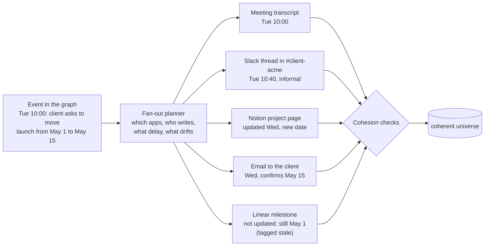

Cohesion checks, run across all apps:

- **Identity.** One person, one identity, with realistic variation (full name in email, first name and a handle in Slack).
- **References.** Every link, mention, and ID resolves to something that exists in the right app.
- **Time.** Each artifact falls inside its event's window, in a plausible order, with plausible delays.
- **Agreement.** Apps agree with the graph, except where a tagged drift says they should not (the stale Linear date above).
- **Access.** People only see and write what their permissions allow.

### 8.3 The environment at run time

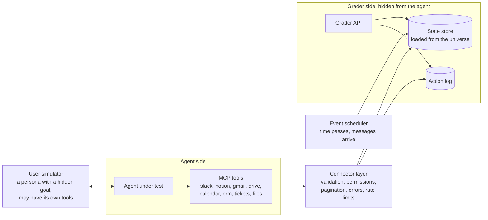

Each run gets its own copy of the store, loaded from a universe snapshot, so runs are repeatable and parallel. A persona plays the user with a hidden goal (τ-bench), sometimes with tools of its own (τ²-bench), and a scheduler lets time pass and new messages arrive (ARE).

## 9. Benchmarks and evals

### 9.1 Recipes

A recipe is a small plug-in: a payload schema, how to build items from the world, which gates apply, how to grade, and how a reviewer sees it.

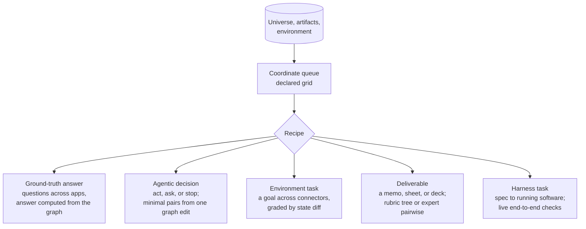

### 9.2 Ground truth by construction

Where the premise (2.5) does its work. Four kinds of ground truth, produced in this order, each checked by someone other than the maker.

| Ground truth | What it is | Where it comes from | Checked by |
|---|---|---|---|
| **Gold outcome** | The correct answer or end state | Computed from the graph | Re-derived by code; a jury for free text |
| **Golden trajectory** | The maker's path: reads, writes, and decisions, in order | Recorded while building the item backwards | Replayed in the environment to prove it reaches the gold |
| **Silver trajectories** | Successful runs by independent solvers | A **keyed solver** (with the answer key) and a **blind panel** (cross-lab, no key) | Graded by the gold outcome; only verified successes count |
| **Rubric** | Checkpoints, forbidden actions, outcome criteria | What golden and silver trajectories share, and what failed runs did wrong | Reviewed and edited by an expert |

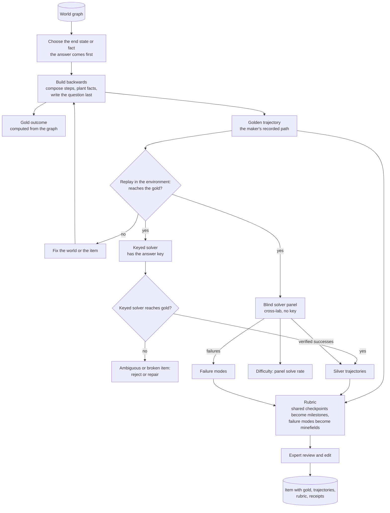

- **The keyed solver tests the item.** If it cannot reach the gold even with the answer key, the item is ambiguous, the world is inconsistent, or the tools cannot do the task.
- **The blind panel tests the models.** Its solve rate is the difficulty. Its successes add valid paths so the rubric does not punish a route the maker did not take. Its failures show where the item bites.

Grading order: **outcome first** (exact answer, or state diff plus a collateral-damage check); **milestones second** (checkpoints every valid path shares; ToolSandbox); **minefields always** (harmful actions no valid path took); **rubric judges only for free text**.

| Recipe | Gold outcome | Golden trajectory | Rubric emphasis |
|---|---|---|---|
| Ground-truth answer | Query on the graph | Which artifacts, in which apps, a reader must open | Grounding: cites the right, current source |
| Agentic decision | The right action, from the minimal pair's one differing fact | The reads that reveal the fact | Minefield: the harmful commit |
| Environment task | Expected state after the task | Backward construction from the end state | Milestones, no collateral damage |
| Deliverable | Required facts and structure, from the graph | The maker's outline and sources | Rubric tree; expert pairwise at the top |
| Harness task | The spec's acceptance tests passing on the live app | A reference build or a known-good run | End-to-end workflows, then trace checks |

### 9.3 Item gates and graders

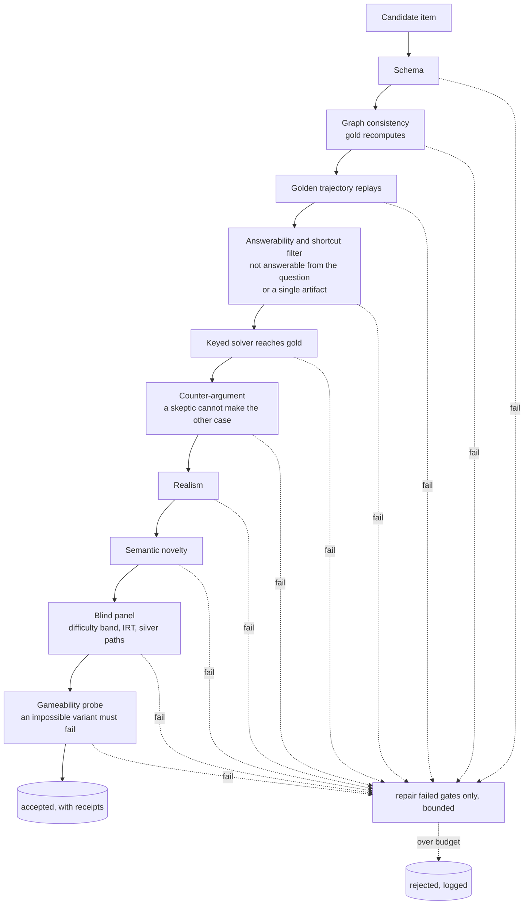

| Grader | Use for | Reference |
|---|---|---|
| Exact, numeric, schema | Ground-truth answers | SimpleQA, LiveBench |
| State diff plus collateral check | Environment tasks | τ-bench, WorkBench, AppWorld |
| Write-action oracle with order and timing | Decisions, multi-step tasks | ARE Verifier, ToolSandbox |
| Tests over the product | Harness tasks | SWE-bench, SWE-Lancer, BackendForge |
| Jury of judges on a rubric | Free text, deliverables | PoLL, PaperBench, HealthBench |
| Blind expert pairwise | Open-ended work product | GDPval |

### 9.4 Designing an eval

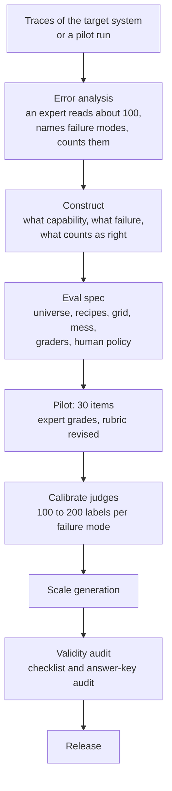

An eval spec is one versioned YAML file: which universe, which recipes and their share of the grid, mess operators and rates, gates, graders, difficulty targets, human review policy, and release split. Any eval can be regenerated from its spec and seed.

### 9.5 Evaluating an agent harness

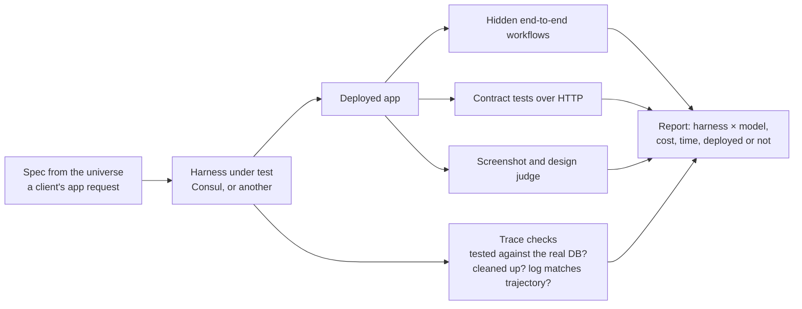

A real Consul run already shows why trace checks matter: its tests ran on SQLite despite the rule to use the real database.

### 9.6 Running an eval

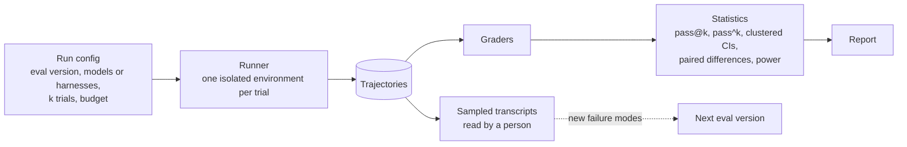

Build on an existing runtime rather than a new one: Inspect (UK AISI) is the leading candidate, with task directories in the Harbor or OpenEnv style. New hard evals live in a capability suite; once saturated, they move to regression.

## 10. The agentic loop every layer shares

Intake, universe, artifacts, connectors, and items all run the same loop. Only the checkers change.


| Layer | What the checkers ask |
|---|---|
| Universe | Is the graph consistent: dates, sums, identities, knowledge over time? |
| Artifacts | Is the file valid, faithful, in voice, realistic, novel? |
| Connectors | Does every app agree with the graph and with each other, except tagged drift? |
| Benchmark items | Is the gold right, the item solvable, realistically hard, and not gameable? |

Loop rules: the maker never marks its own work passed; only failed checks rerun, for a bounded number of rounds; every result is stored with its receipt; the declared grid, not the model, decides coverage; workers claim coordinates from a claims file so loops run in parallel and survive crashes. Makers and checkers are Claude Code skills and subagents by default, run headless; any harness that can read files, run code, and call models can drive the same loop.

## 11. Where humans sit

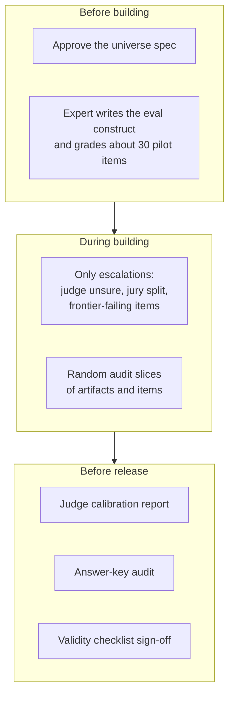

| Essential | Optional or replaced |
|---|---|
| Approving the universe spec and the eval construct | Objective checks (schema, tests, state) |
| Calibrating every judge (100 to 200 labels per mode) | Bulk filtering of candidates |
| Subjective or high-stakes domains | Comparing systems over many items |
| Reviewing hard, frontier-failing items | Structured fake records |
| Reading transcripts and auditing answer keys | |

In enterprise use, the customer's experts own the rubric, and their real data never enters the universe; only measured structure and mess do.

## 12. Data model

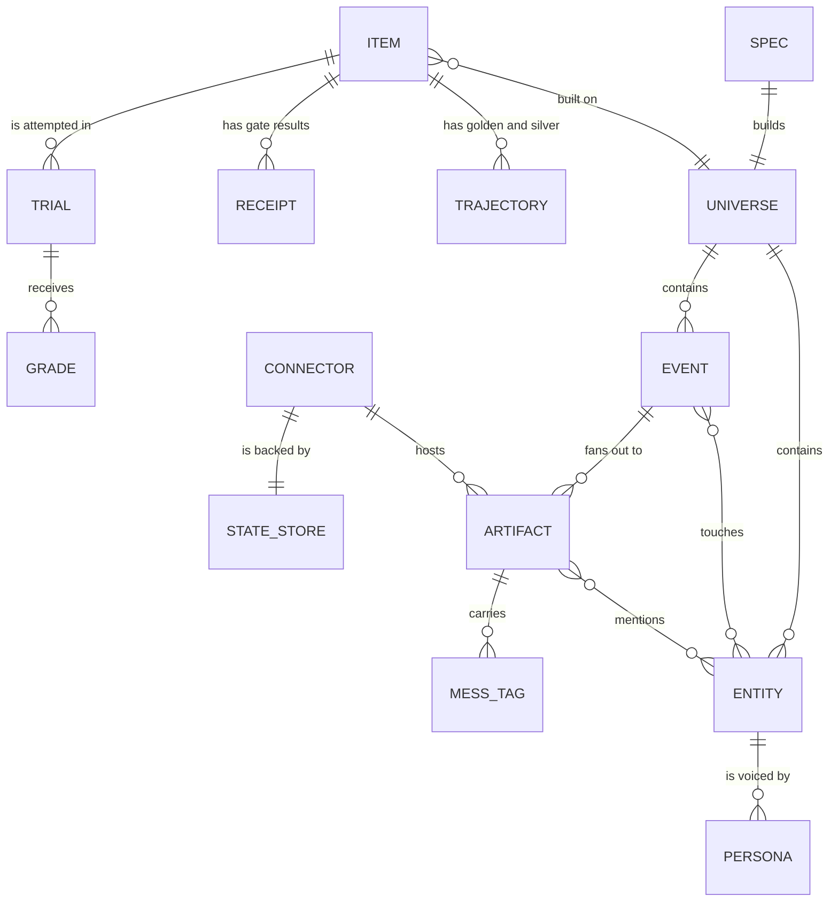

- **Spec:** source (description, seed, open-source profiles), persona answers, grid, mess profile, size, seed.
- **Universe:** graph (entities, events, timeline, knowledge), personas, hash.
- **Artifact:** app, type, source event, author persona, graph node IDs, mess tags, receipt.
- **Connector:** app schema version, store snapshot, tool surface, exporter version.
- **Item:** recipe, payload, gold outcome, golden trajectory, silver trajectories, rubric, receipts, difficulty, split, canary.
- **Trial:** model or harness, config, trajectory, grades, cost, time.

## 13. Repository layout

Proposed, for when code arrives. Today only `README.md` and `research/` exist.

```
demiurge/
├── README.md               # this design
├── research/               # findings that hold regardless of design
├── specs/                  # universe and eval specs (YAML), versioned
├── intake/                 # questionnaire, intake agent, seed profiler (runs locally)
├── sources/                # open-source connectors, license ledger, structure and mess profilers
├── universe/               # skeleton builder, persona agent, timeline simulator, consistency checks
├── artifacts/
│   ├── renderers/          # one per file type
│   └── mess/               # mess operators, tagged and reversible
├── connectors/
│   ├── slack/              # schema, renderer, store, tools (MCP), exporter
│   ├── notion/
│   ├── gmail/
│   ├── drive/
│   └── ...                 # one folder per app, same five parts
├── cohesion/               # event fan-out planner and cross-app checks
├── environments/           # runtime: store loading, user simulators, event scheduler, grader API
├── recipes/                # ground-truth, decision, env-task, deliverable, harness
├── construction/           # backwards builder, golden replay, keyed and blind solvers, rubric derivation
├── gates/                  # shared and per-layer gates, each returns a receipt
├── graders/                # exact, state-diff, action-oracle, tests, jury, pairwise
├── loop/                   # the shared maker/checker loop, claims, repair, reflection
├── harness/                # runner (Inspect adapter), trial isolation
├── review/                 # review queue, sampling, escalation
├── stats/                  # pass@k, pass^k, CIs, IRT, power
├── release/                # splits, canaries, dedup, errata
└── .claude/                # skills and subagents that drive the loop in Claude Code
```

## 14. Metrics and statistics

One definition each, used everywhere:

| Metric | Definition |
|---|---|
| **pass@k** | Probability at least one of k attempts succeeds (unbiased estimator from n ≥ k trials). Capability. |
| **pass^k** | Probability all k attempts succeed. Reliability (τ-bench). |
| **mean success** | Average success over trials. |
| **item difficulty** | Panel solve rate, plus an IRT difficulty and discrimination fit. |
| **judge quality** | True positive and true negative rates against human labels, per failure mode. |
| **realism** | Share of artifacts a blind judge cannot tell from real examples, per file type. |
| **cohesion** | Share of cross-app references, identities, and timings that pass the cohesion checks. |

Every headline number gets a clustered 95% interval; models are compared with paired differences; power is checked before claiming a gap.

## 15. Contamination and release

- **Splits:** public, held-out (scores only), private.
- **Canaries** in every released file.
- **Semantic deduplication** against public benchmarks and earlier releases.
- **Fresh universe seeds** per release; old items retire into regression suites.
- **Errata:** a public log of fixed items and grader changes.

## 16. Build order and next steps

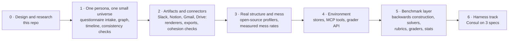

Immediate next steps:

1. **Agree the design:** the layers, their principles, and the three ways in.
2. **Write the persona questionnaire** and run it for a first focal persona (a solo founder or a small agency owner is a good start: rich in Slack, Notion, email, and client documents, small enough to build).
3. **Write the first universe spec** from those answers, before any code.
4. **Measure mess for three types** (Slack, email, spreadsheet) from open sources.
5. **Review Backlot** and decide whether to build connectors on it or alongside it.
6. **Settle the runtime:** Inspect with Harbor-style tasks, or a lighter harness.
7. **Decide the extraction boundary** for existing private work (Escalation Bench generator, persona-artifact-factory), which also decides when this repo goes public.

## 17. Open questions

- How realistic is realistic enough? A blind real-versus-synthetic judge is one test; agreement between model rankings on the synthetic world and on a partner's real data is the stronger one.
- How big must a universe be before scale effects show?
- How do several evals share one universe without leaking answers between them?
- How much should the user simulator vary, given scores swing by up to 9 points across simulator models ("Lost in Simulation")?
- Which connectors matter most first? Slack and Notion are assumed; this should be checked against what agents are actually deployed on.
- Where does the enterprise version run: on the customer's machines, ours, or both?

## Naming

Undecided. The working title, Demiurge (Plato's craftsman who shapes a working world from ideal forms), is a placeholder. The name should say what this is: a maker of believable worlds for testing agents, with an answer key.

---

Research notes: [`research/`](research/README.md).
