# Demiurge

**Worlds for evals. Built by agents, checked by everything else.**

Demiurge is a design for a synthetic data engine. It builds believable company worlds (people, projects, timelines, and the messy files and tools they leave behind), turns them into evals and agent environments, and proves every piece is sound before anyone scores a model against it. Claude Code, or any agentic harness, does the making. Code, independent models, and people do the checking.

> **Status: design only.** This repo holds the design and the research behind it, so the design can change quickly. No engine code yet. The research in [`research/`](research/) stands on its own and applies whichever design we pick.

The name is a working title. In Plato's *Timaeus*, the demiurge is the craftsman who shapes a working world out of ideal forms. That is the job here: forms in (specs, seeds, real-world patterns), a coherent world out. See [Naming](#naming).

---

## Contents

1. [First principles](#1-first-principles)
2. [Scope](#2-scope)
3. [The system at a glance](#3-the-system-at-a-glance)
4. [Stage by stage](#4-stage-by-stage)
5. [The agentic loop every stage shares](#5-the-agentic-loop-every-stage-shares)
6. [Designing an eval](#6-designing-an-eval)
7. [Running an eval](#7-running-an-eval)
8. [Where humans sit](#8-where-humans-sit)
9. [Data model](#9-data-model)
10. [Repository layout](#10-repository-layout)
11. [Metrics and statistics](#11-metrics-and-statistics)
12. [Contamination and release](#12-contamination-and-release)
13. [Build order and next steps](#13-build-order-and-next-steps)
14. [Open questions](#14-open-questions)
15. [Naming](#naming)

---

## 1. First principles

These come from the literature and practitioner canon in [`research/`](research/). Each is load-bearing for the design.

1. **Trust is the product, and volume is cheap.** A model can write a thousand eval items in an afternoon, with reference answers that are quietly wrong. Audits of famous benchmarks keep finding it: about 59% of audited SWE-bench Verified failures had flawed tests, roughly 30% of Humanity's Last Exam chemistry and biology answers look wrong, and 6.5% of MMLU items are erroneous. Everything below exists to make an item trustworthy, and the receipts to prove it travel with the item.
2. **The world comes first, and the documents are rendered from it.** Generate a typed, time-stamped graph of the company (people, clients, projects, contracts, decisions, events), then render every email, spreadsheet, and transcript from it. Gold answers are computed from the graph, not labeled by a model. (CorporateBench, Era by Eon, HERB, EntiGraph.)
3. **Diversity has to be designed in.** Models converge on each other's outputs ("Artificial Hivemind", NeurIPS 2025), so switching generator vendors buys little. Diversity comes from structure: personas, roles, document types, audiences, and noise profiles, combined from a declared grid. (Persona Hub, DataMorgana, Cosmopedia.)
4. **Real mess is copied deliberately.** Real company data is full of forwarded chains, stale versions, conflicting numbers, misfiled documents, half-filled CRM fields, and near-duplicates. Agents fail on exactly those. We study real artifacts to measure that mess, then apply it on purpose, and tag every piece of it in the graph so graders know it is there.
5. **Separate the author from every judge.** The model that writes an item never approves it, and never grades it alone. LLM-built benchmarks rank their own author first ("When LLMs Benchmark Themselves", 2025). Generator, judges, and the model under test come from different families where possible, and results are reported across generators.
6. **State lives in code. Language models write content.** Tools and connectors read and write a real, typed state store. A language model writes email bodies and document text at seed time, but never owns the state, because simulated state breaks as soon as several fields must change together (EnvSimBench's "state change cliff"). (AppWorld, τ-bench, ARE.)
7. **Use the cheapest grader that can be right.** Schema checks, then graph consistency, state diffs, and tests. Then a jury of model judges from different families. Then people. A judge is itself a model with a test set, and its agreement with humans is reported.
8. **People own the definition of quality.** Criteria drift as soon as you grade real outputs ("Who Validates the Validators?"). A domain expert writes and revises the rubric by grading samples, reviews the disagreement set, and calibrates every automated judge. Hard items get more human review, not less.
9. **Difficulty is measured.** A panel of models from several labs attempts every item. Items that do not separate models, or that can be answered from a shortcut (the question alone, a single file), are dropped. Item response theory places each item on a scale.
10. **Every claim carries error bars.** Report pass@k and pass^k over at least four trials, with clustered confidence intervals and a power check before saying one model beats another.
11. **Contamination is a lifecycle.** Canary strings, semantic deduplication, public, held-out, and private splits, fresh seeds per release, and a published errata log.
12. **Keep the pool, add to it.** Item pools are versioned and append-only, with human-sourced anchor items in every release, and full provenance on every item. (Accumulate, don't replace: Gerstgrasser et al. 2024.)

## 2. Scope

**In scope**

- Universes: seeded company worlds with personas, org structure, relationships, and timelines.
- Artifacts: files of many types rendered from a universe, with realistic mess.
- Seeds: pulling open-source and public-record artifacts, and studying real company artifacts and user data to model their mess.
- Environments: synthetic connectors (mail, chat, drive, calendar, CRM, tickets, files, SQL) that agents call as tools, backed by the universe.
- Evals: item recipes, quality gates, graders, a harness to run them, human review, statistics, and release.
- Evaluating agent harnesses, starting with [Consul](https://github.com/nbdesai1992/consul) (spec to deployed app).

**Out of scope, for now**

- Post-training. The same worlds and graders could later produce reward signals and preference data, but that is a separate cookbook with different quality bars (reward hacking resistance above all). The design keeps the door open by making every grader callable on its own.

## 3. The system at a glance

Seven stages, each a pure step with files in and files out. Every stage runs the same agentic loop (section 5).

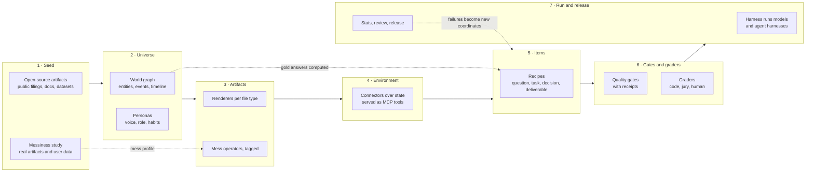

The two dotted arrows carry the design. Mess learned from real data flows straight into rendering, and gold answers flow from the graph, never from a model's opinion.

## 4. Stage by stage

### 4.1 Seed: real material and real mess

Two jobs. Gather open-source artifacts to ground the world in real structure, and measure how real company data is messy so we can reproduce that mess.

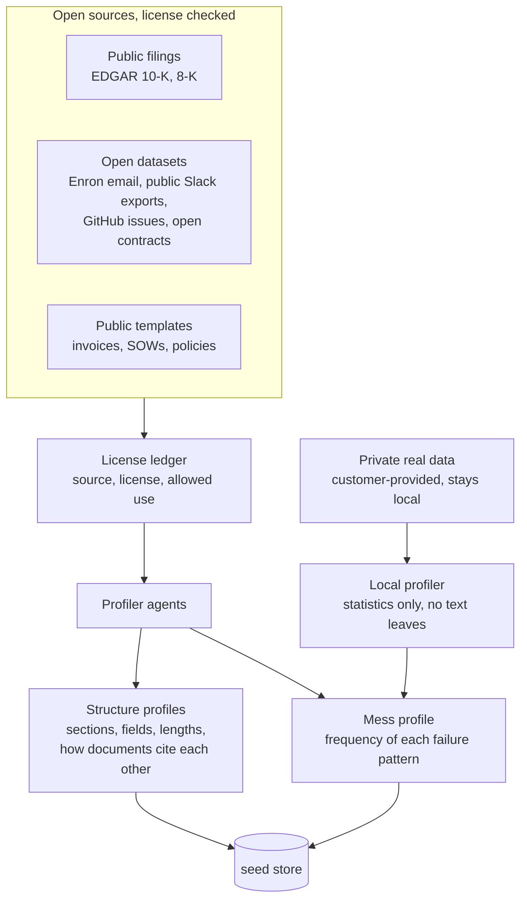

- **License ledger.** Every source has a license and an allowed-use entry before anything is read. Anything not cleared stays out.
- **Structure profiles.** What a real SOW, board deck, or support thread looks like: sections, field shapes, lengths, and how documents reference each other.
- **Mess profile.** Measured rates of each failure pattern. Real data from a customer never leaves their machine; only the statistics do.
- **The messiness taxonomy** (a starting list, to be measured, not assumed):

| Family | Examples |
|---|---|
| Versioning | final_v3_REAL.docx, superseded figures still circulating, edits after sign-off |
| Duplication | near-duplicate files, the same thread forwarded twice, copy-pasted tables that drifted |
| Conflict | two sources disagree on a date or number; the chat decision contradicts the spec |
| Omission | half-filled CRM fields, missing attachments, "see attached" with nothing attached |
| Misplacement | misfiled documents, wrong project folder, a decision buried in an unrelated thread |
| Format damage | OCR noise, broken tables, merged cells, CSVs with shifted columns, timezone mixups |
| Human habits | typos, shorthand, inside jokes, replies above the quote, emoji as answers |
| Access | files only some people can see, stale permissions, shared links to deleted files |

### 4.2 Universe: the world graph and the people in it

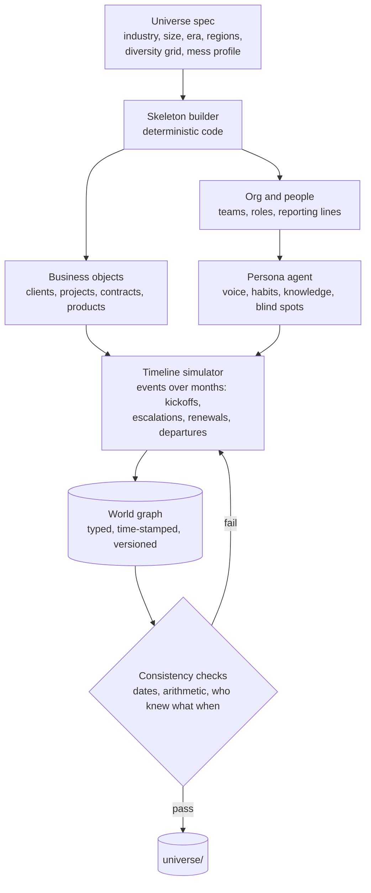

- **Deterministic skeleton, generative detail.** Code lays down the org chart, objects, and the calendar of events from the spec and a seed, so the same seed always gives the same world. Agents fill in persona voice and event detail.
- **Personas.** Each person has a voice, role, habits (terse, over-explains, always late on Fridays), what they know, and when they learned it. Persona conditioning is the main source of variety.
- **Timeline.** Events happen in order and change the graph: a price changes in March, a contact leaves in May. Later documents must respect earlier events, which is what makes "latest correct figure" questions answerable.
- **Knowledge per person, over time.** Who knew what, and when. It powers questions like "should the agent have known this when it acted?"

### 4.3 Artifacts: one loop per file

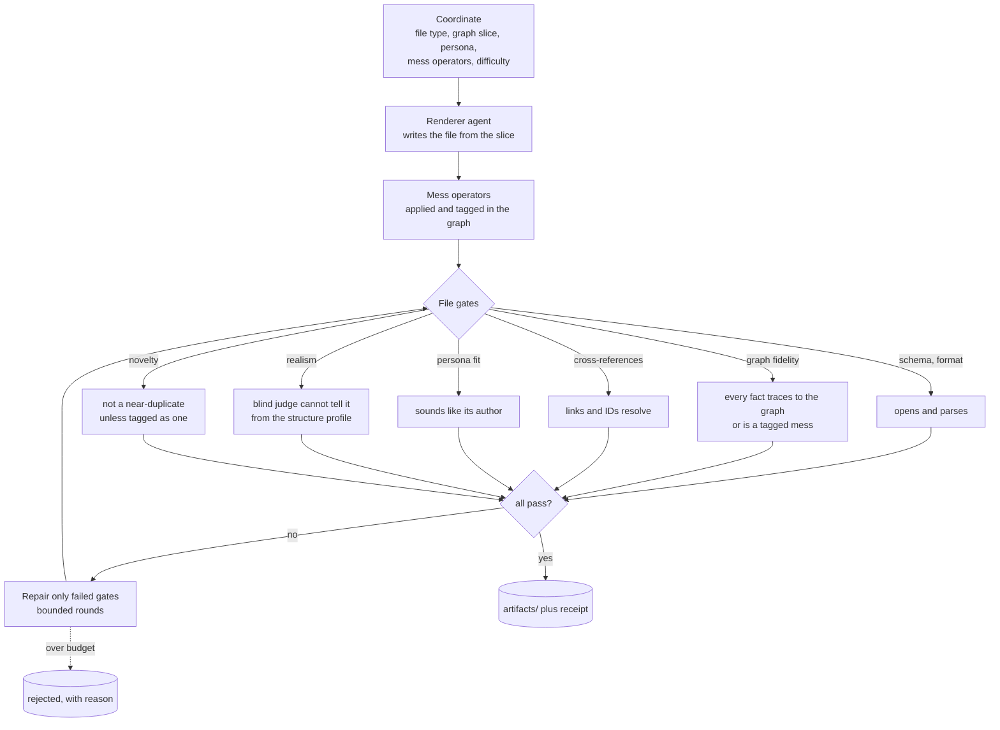

File types, first wave and later:

| First wave | Later |
|---|---|
| Email threads, chat channels, meeting transcripts, contracts and SOWs (DOCX/PDF), spreadsheets with formulas (XLSX), CRM records, tickets | Slide decks, code repositories (break a working repo, SWE-smith style), calendar, scanned PDFs, wiki pages, audio transcripts |

Each renderer declares its own gates on top of the shared ones: a spreadsheet's formulas must recompute to the graph's figures; a contract's parties and dates must match the graph; a transcript's speakers must have been in the meeting.

### 4.4 Environment: connectors over state

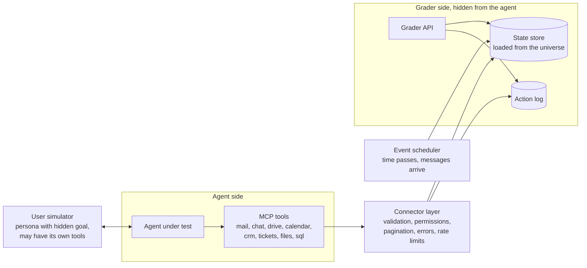

- **Thin tools over real state.** A tool is a validated operation on the store (AgentScaler's "tool equals a database operation"). Reads are cheap and ungraded; writes are what matter.
- **Realistic edges.** Preconditions, permissions, pagination, errors, and rate limits, because happy-path tools inflate scores (ToolSandbox, EnterpriseBench).
- **Hidden grader API.** Graders read the true state and the action log. The agent cannot reach them.
- **User simulator and events.** A persona with a hidden goal plays the user (τ-bench), sometimes with tools of its own (τ²-bench). A scheduler lets time pass and messages arrive (ARE).
- **Reset and isolation.** Each run gets its own copy of the state, loaded from the universe snapshot, so runs are repeatable and parallel.

### 4.5 Items: recipes that ride on the world

A recipe is a small plug-in: a payload schema, how to generate from the world, which gates apply, how to grade, and how a reviewer sees it.

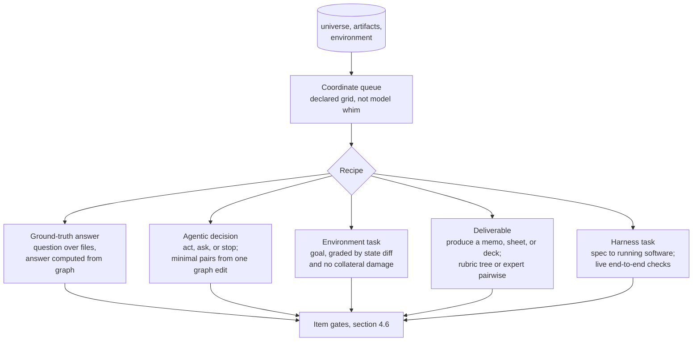

- **Ground-truth answer.** Questions over the files ("what is the current renewal price for Harbor & Pine?"), answered by computing from the graph, including unanswerable questions and planted conflicts.
- **Agentic decision.** The Escalation Bench shape: read freely, then commit, ask, or stop. Minimal pairs come from one graph edit, re-rendered.
- **Environment task.** A goal in the connected world ("move every overdue invoice owner's next meeting before Friday"), graded by diffing state and checking nothing else changed.
- **Deliverable.** Produce a work product. Graded by a rubric tree (criteria typed as outcome, process, grounding, or safety; must or must-not; gate or additive) or blind pairwise against an expert reference (GDPval).
- **Harness task.** For agent harnesses like Consul: a spec in, a deployed app out. Graded on the live URL (section 6.3).

### 4.6 Gates and graders

Gates decide whether an item is fit to exist. Graders score a model's attempt at it. Both run cheapest first.

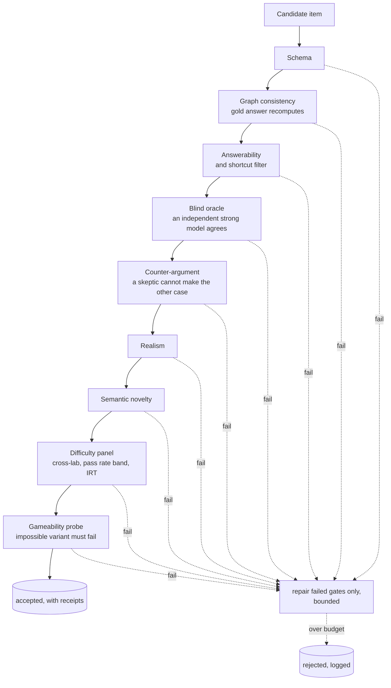

Graders, in order of preference:

| Grader | Use for | Reference |
|---|---|---|
| Exact, numeric, schema | Ground-truth answers | SimpleQA, LiveBench |
| State diff plus collateral check | Environment tasks | τ-bench, WorkBench, AppWorld |
| Write-action oracle with order and timing | Decisions and multi-step tasks | ARE Verifier, ToolSandbox milestones |
| Tests over the product | Harness tasks | SWE-bench, SWE-Lancer, BackendForge |
| Jury of judges on a rubric | Free text, deliverables | PoLL, PaperBench, HealthBench |
| Blind expert pairwise | Open-ended work product | GDPval |

Every model judge ships with its own labeled validation set, its agreement with humans, and both answer orders tested.

## 5. The agentic loop every stage shares

Every stage above is the same loop with different contents. This is where Claude Code, or another harness, does the work.

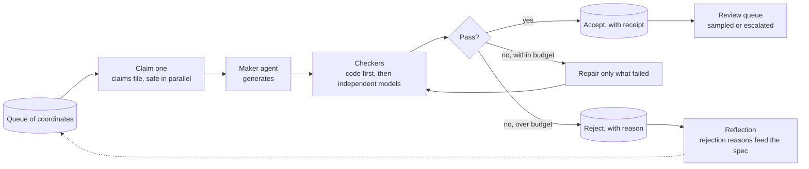

Rules the loop enforces:

- **The maker never accepts its own work.** Checkers are code or a different model; a maker cannot mark a gate passed.
- **Bounded repair.** Only failed gates rerun. A capped number of rounds, then an honest rejection.
- **Receipts.** Every gate result, model, prompt hash, seed, and repair is stored with the output.
- **Coverage is declared.** The queue, built from the spec's grid, decides what gets made, not the model's preferences.
- **Parallel and resumable.** Workers claim coordinates from a claims file, so many loops run at once and a crash loses nothing. (This is the pattern from the Escalation Bench generator.)
- **Harness-agnostic.** Makers and checkers are Claude Code skills and subagents by default, invoked headless. Any harness that can read files, run code, and call models can drive the same loop.

## 6. Designing an eval

### 6.1 From failures, not from metrics

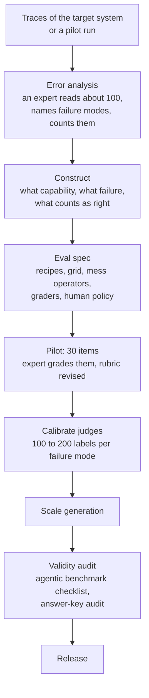

This follows the practitioner consensus (Husain and Shankar; Anthropic's agent eval guidance): look at data before choosing metrics, start with 20 to 50 tasks from real failures, and treat every judge as a model with its own test set.

### 6.2 The eval spec

One YAML file declares an eval: the universe it uses, the recipes and their share of the grid, the mess operators and rates, the gates, the graders, difficulty targets, the human review policy, and the release split. Specs are versioned, so an eval can be regenerated from its spec and seed.

### 6.3 Evaluating an agent harness

The first harness is Consul. The task is a spec, and the environment is a sandboxed deployment workspace.

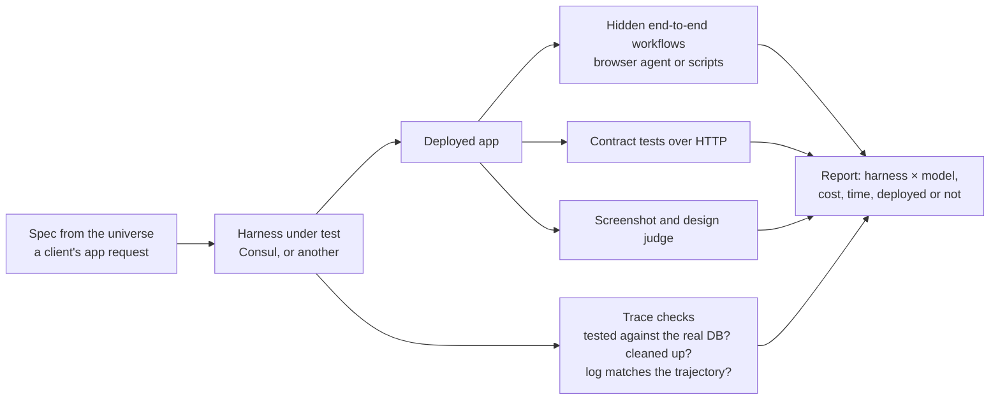

A real Consul run already shows why the trace checks matter: its tests ran on SQLite despite the rule to test against the real database. An eval should catch that automatically.

## 7. Running an eval

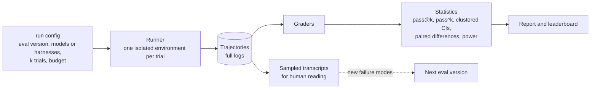

- **Runtime.** Build on an existing harness rather than inventing one. Inspect (UK AISI) is the leading candidate, with task directories in the Harbor or OpenEnv style (a container, an instruction, a verify script).
- **Always read transcripts.** A sample of every run goes to a person. Most eval bugs are found this way.
- **Capability versus regression.** New, hard evals live in the capability suite. Once saturated, they move to regression.

## 8. Where humans sit

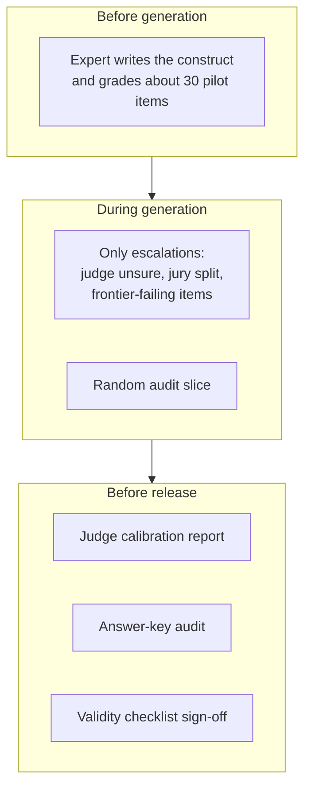

| Essential | Optional or replaced |
|---|---|
| Defining quality and naming failure modes | Objective checks (schema, tests, state) |
| Calibrating every judge (100 to 200 labels per mode) | Bulk filtering of synthetic candidates |
| Subjective or high-stakes domains (law, finance, medicine) | Comparing systems in aggregate over many items |
| Reviewing hard, frontier-failing items | Structured fake records (a faker library does it) |
| Reading transcripts and auditing answer keys | |

In enterprise use, the customer's experts own the rubric, and their real data never enters the synthetic world. Only its measured mess does.

## 9. Data model

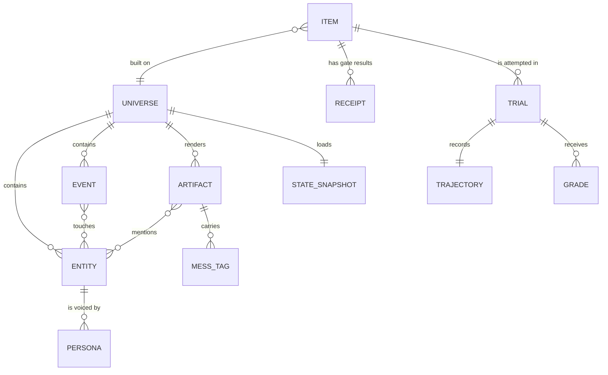

- **Universe:** seed, spec version, graph (entities, events, timeline), personas, and a hash.
- **Artifact:** file, type, renderer version, graph node IDs it draws from, mess tags, receipt.
- **Item:** recipe, payload, gold answer or grader config, graph provenance, gate receipts, difficulty stats, split, canary.
- **Trial:** model or harness, config, trajectory, grades, cost, time.

## 10. Repository layout

The proposed layout for when code arrives. Today only `README.md` and `research/` exist.

```
demiurge/
├── README.md               # this design
├── research/               # findings that hold regardless of design
├── specs/                  # universe and eval specs (YAML), versioned
├── seed/
│   ├── sources/            # connectors to open sources + license ledger
│   └── profiles/           # structure profiles and mess profiles
├── universe/               # skeleton builder, persona agent, timeline simulator, consistency checks
├── artifacts/
│   ├── renderers/          # one per file type (email, chat, transcript, contract, xlsx, crm, ticket, ...)
│   └── mess/               # mess operators, each tagged and reversible
├── environments/
│   ├── store/              # state store loaded from a universe
│   ├── connectors/         # mail, chat, drive, calendar, crm, tickets, files, sql (MCP)
│   ├── users/              # user simulators
│   └── events/             # scheduler
├── recipes/                # ground-truth, decision, env-task, deliverable, harness
├── gates/                  # shared gates + per-recipe gates, each returns a receipt
├── graders/                # exact, state-diff, action-oracle, tests, jury, pairwise
├── loop/                   # the shared maker/checker loop, claims, repair, reflection
├── harness/                # runner (Inspect adapter), trial isolation
├── review/                 # review queue UI, sampling, escalation
├── stats/                  # pass@k, pass^k, CIs, IRT, power
├── release/                # splits, canaries, dedup, errata
└── .claude/                # skills and subagents that drive the loop in Claude Code
```

## 11. Metrics and statistics

Settled definitions, used everywhere (our earlier writing used three different meanings of pass@k):

| Metric | Definition |
|---|---|
| **pass@k** | Probability that at least one of k attempts succeeds (unbiased estimator from n ≥ k trials). Measures capability. |
| **pass^k** | Probability that all k attempts succeed. Measures reliability (τ-bench). |
| **mean success** | Average success rate over trials. What Escalation Bench reports as its accuracy. |
| **item difficulty** | Panel solve rate, and an IRT difficulty and discrimination fit. |
| **judge quality** | True positive and true negative rate against human labels, per failure mode. |

Report every headline number with a clustered 95% interval, compare models with paired differences, and check power before claiming a gap.

## 12. Contamination and release

- **Splits.** Public (for development and examples), held-out (published scores only), private (never leaves our control).
- **Canaries.** A unique string in every released file.
- **Deduplication.** Semantic, not only n-gram, against public benchmarks and our own earlier releases.
- **Freshness.** A new universe seed per release; old items retire into regression suites.
- **Errata.** A public log of fixed items and grader changes, with version numbers.

## 13. Build order and next steps

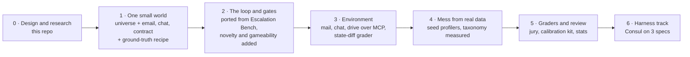

Immediate next steps:

1. **Agree the design** in this README: principles, stages, and the loop.
2. **Pick the first world:** a mid-size services firm (clients, SOWs, invoices, a support desk) is small enough to build and rich enough for every recipe.
3. **Write the first two specs:** a universe spec and one ground-truth eval spec, before any code.
4. **Measure mess for three file types** (email, spreadsheet, contract) from open sources, to replace the taxonomy guesses with rates.
5. **Settle the runtime:** Inspect with Harbor-style task directories, or a lighter standard-library harness.
6. **Decide the extraction boundary** for existing private work (Escalation Bench generator, persona-artifact-factory).

## 14. Open questions

- How realistic is realistic enough? A blind "real or synthetic" judge is one test; downstream agreement with evals on real data is the stronger one, and needs a partner with real data.
- How big must a world be before scale effects show? CorporateBench finds performance drops as a corpus nears realistic size.
- How are universes shared across evals without leaking answers between them?
- How much should the user simulator vary, given scores swing by up to 9 points across simulator models ("Lost in Simulation")?
- Where does the enterprise version run: on the customer's machines, ours, or both?

## Naming

Working title: **Demiurge**, Plato's world-shaping craftsman. It fits the job (forms in, a working world out) and is unclaimed in the AI space. It is the only Greek name in a family that is otherwise Roman or plain English (Consul, Overtone, Relay).

Other candidates, with their catch:

| Name | Idea | Catch |
|---|---|---|
| **Opifex** | Latin "maker"; Cicero's *opifex rerum*, the maker of the world. Roman, like Consul | Less known; sounds technical |
| **Forma** | Latin "form, mould"; the *Forma Urbis Romae* was a marble map of all of Rome | Crowded name in software |
| **Tessera** | The single tile of a Roman mosaic; worlds built from small pieces | Too close to Tesseract (OCR) |
| **Simulacra** | Copies convincing enough to stand in for the real thing | Echoes "Generative Agents: Interactive Simulacra" |
| **Verisim** | From verisimilitude, the quality of seeming true | Small collision with a Verilog tool |

---

Research notes: [`research/`](research/README.md).
